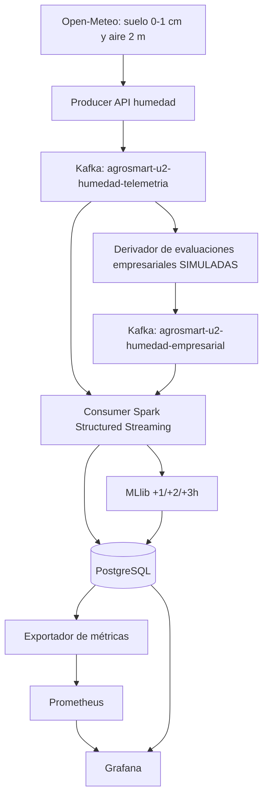

# Arquitectura de extremo a extremo



## Equivalencia con `lambda26`

| Docente | AgroSmart Puno | Función |
|---|---|---|
| `kafka/` | `kafka/` | Broker, UI y Kafka Exporter |
| `pyspark/` | `pyspark/` | Jupyter batch + consumer Spark persistente |
| `obs/` | `obs/` | Prometheus, alertas, Grafana |
| `uso-atmos/` | `uso-agrosmart/` | Producer Open-Meteo, derivador empresarial y consumers de prueba |
| `docs/` | `docs/` | MkDocs, brief, rúbrica, evidencias por sesión |
| `.github/workflows/` | `.github/workflows/` | Publicación del sitio en GitHub Pages |

## Contrato de datos

`agrosmart-u2-humedad-telemetria`: `evento_id`, `fecha_evento` (UTC), `ubicacion`, `humedad_suelo_m3m3`, `humedad_suelo_pct`, `humedad_aire_pct`, `origen`, `modo_publicacion`, `emitido_utc`. Se calcula `humedad_suelo_pct = humedad_suelo_m3m3 × 100`. La humedad relativa del aire ya llega en `%`. Los contratos exactos están en `uso-agrosmart/contratos`.

`agrosmart-u2-humedad-empresarial`: cada telemetría produce una evaluación simulada `revision_manual` o `seguimiento`. El umbral 20 % solo permite mostrar un flujo empresarial reproducible; no equivale a una recomendación agronómica real.

## Semántica streaming

El consumer Spark utiliza **tres consultas** con checkpoints distintos. `telemetria` deduplica por `evento_id` con watermark 2 horas; `empresarial` deduplica eventos de evaluación; `ventanas` agrega humedad del suelo y aire por ventanas de 1 hora, watermark 2 horas y modo `update`. En PostgreSQL, `ON CONFLICT` permite reintentos idempotentes de los mismos identificadores.

Las métricas de Kafka y Spark no son idénticas: un offset confirma publicación, no procesamiento o persistencia. El progreso debe acreditarse con tabla y logs. En Kafka de un nodo y Spark `local[2]` hay procesamiento distribuido local de Spark, no alta disponibilidad ni clúster multinodo.

## Segunda dimensión (Mijael · temperatura) sobre la misma infraestructura
Mismo patrón Lambda y mismos servicios (Kafka, Spark, PostgreSQL, Prometheus, Grafana), con **tópicos, tablas, modelo y consumer propios**:

```
Open-Meteo temperature_2m (Azángaro) → producer_api_temperatura → Kafka agrosmart-u2-temperatura-telemetria
   → spark-consumer-temperatura (temp_telemetria · temp_empresarial · temp_ventanas) → PostgreSQL *_temperatura → Grafana (fila 07)
Evaluaciones de riesgo de helada → Kafka agrosmart-u2-temperatura-empresarial
```

