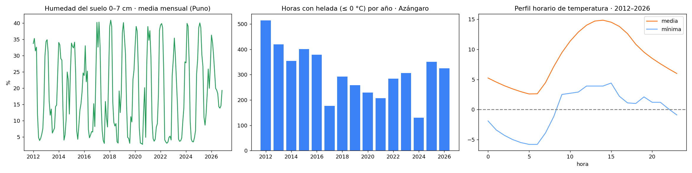
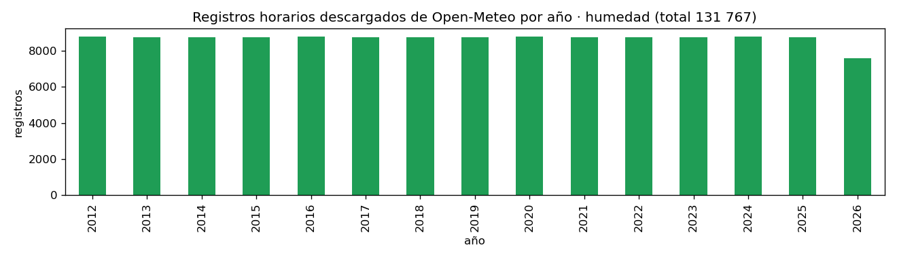
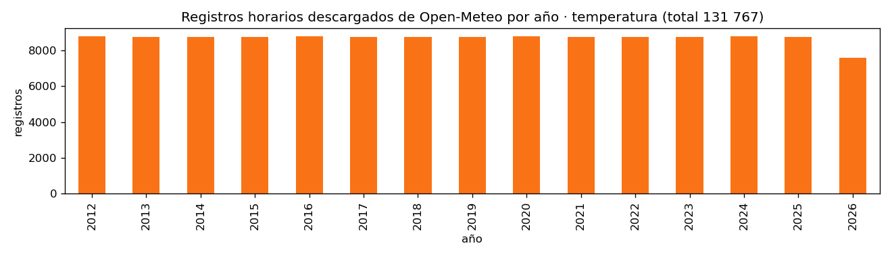

# Big Data histórico · Open-Meteo 2012–2026

**263 534 registros reales descargados de la API Open-Meteo: 131 767 por dimensión.** No son datos sintéticos: son 1 447 registros recientes de la Forecast API (los que alimentan el streaming y el modelo U2) más 130 320 horas históricas de la Historical Weather API (reanálisis ERA5 / ERA5-Land), procesadas con Spark en arquitectura medallón.

| Dimensión | Forecast API · últimos 60 días | Historical API ERA5 · 2012-01-01 → 2026-11-12 | Total descargado |
|---|---:|---:|---:|
| Humedad · José (Puno, −15.84, −70.02) | 1 447 | 130 320 | **131 767** |
| Temperatura · Mijael (Azángaro, −14.91, −70.19) | 1 447 | 130 320 | **131 767** |
| **Total** | 2 894 | 260 640 | **263 534** |

## Pipeline (cuaderno `pyspark/sesiones/Historico_BigData/U3_BigData_Historico_OpenMeteo.ipynb`)

1. **Bronze:** un CSV por año y dimensión (30 archivos), descarga idempotente con reintentos (`archive-api.open-meteo.com`).
2. **Silver:** Spark tipa, valida rangos (humedad 0–100 %, temperatura −40 a 40 °C) y elimina duplicados por fecha con `Window + row_number`: **0 nulos, 0 fuera de rango, 0 duplicados** en 130 320 filas por dimensión.
3. **Gold:** Parquet particionado por `anio` y `mes` (179 archivos por dimensión, 1,45 MB y 1,22 MB).
4. **Análisis:** humedad mensual del suelo, horas de helada por año y perfil horario de temperatura.
5. **Modelos +1 h (MLlib):** partición cronológica (entrenamiento hasta 2022: 96 408 filas; validación 2023–2024; prueba desde 2025: 16 343 filas).

Spark corre con `local[*]` (8 núcleos de la laptop) y procesa todo en unos 3,5 minutos.

## Resultados de los modelos con el histórico completo

| Dimensión | Persistencia | Regresión lineal | Gradient Boosted Trees | Lectura |
|---|---:|---:|---:|---|
| Humedad del suelo 0–7 cm (pp) | **0,69** | 0,72 | 0,92 | La persistencia gana: el suelo cambia muy poco entre horas |
| Temperatura a 2 m (°C) | 1,64 | 1,00 | **0,88** | GBT reduce el error un **46 %** |

Catorce años de datos confirman lo que se ve en vivo: la temperatura se puede anticipar mejor que repitiendo el último valor; la humedad del suelo no.

## Cómo se muestra en el sistema

- **Cuadernos U2** (sección 2.1b): cargan la Forecast API y el histórico Gold y muestran «REGISTROS DESCARGADOS DE LA API OPEN-METEO: 131 767».
- **PostgreSQL:** tabla `api_descargas` (dimensión, fuente, registros, desde, hasta).
- **Grafana:** panel «Descargados de Open-Meteo» en el tablero de presentación, para José y para Mijael.

## Aclaraciones

- El archivo histórico no tiene la capa de suelo **0–1 cm** que usa el tiempo real; la más cercana es **0–7 cm**. Por eso el histórico de humedad **no se mezcla** con el entrenamiento del modelo de streaming: se usa para volumen, análisis y el modelo propio de este cuaderno.
- El histórico se publica con unos días de retraso; por eso termina el 12-nov-2026.
- No modifica los datos de U1 ni de U2: todo se guarda en `pyspark/sesiones/Historico_BigData/` (el Bronze no se sube a git; se vuelve a descargar con `ejecutar_historico_bigdata.bat`).
