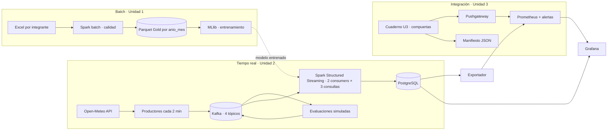

# Informe del proyecto · AgroSmart Puno (Producto Final, Unidad 3)

Informe con las 14 secciones de la Tabla 5 de la rúbrica del producto final. Las cifras salen de los cuadernos, de `resultados/`, de los manifiestos (última ejecución integrada: `20261120T060237Z`, 20-nov-2026 01:02 hora de Perú) y de `evidencias/verificacion_ultima.txt`. No hay cifras estimadas presentadas como medidas.

## 1. Portada

| | |
|---|---|
| **Proyecto** | AgroSmart Puno: monitoreo y predicción a corto plazo del riesgo agroclimático del altiplano (humedad del suelo y heladas) |
| **Curso** | Big Data · Universidad Peruana Unión, Juliaca · semestre 2026-2 |
| **Sección / grupo** | GU · Grupo 11 |
| **Integrantes** | Jose Armando Mamani Poccohuanca (humedad del suelo) · Mijael Yurins Coaquira Justo (temperatura exterior) |
| **Docente** | Ing. Abel Ángel Sullón Macalupú |
| **Repositorio** | [github.com/jose2207/papasmart-bigdata](https://github.com/jose2207/papasmart-bigdata) |
| **Documentación** | [jose2207.github.io/papasmart-bigdata](https://jose2207.github.io/papasmart-bigdata/) |

## 2. Resumen del proyecto

En el altiplano de Puno las heladas y el estrés hídrico del suelo dañan los cultivos, y quien vigila el campo necesita saber no solo cómo están la temperatura y la humedad ahora, sino cómo estarán en las próximas horas. AgroSmart Puno es un sistema Big Data de arquitectura **Lambda** que combina un histórico procesado por lotes con datos que llegan en tiempo real. En la capa batch (U1), Spark limpia el histórico de cada integrante, lo deja en Parquet particionado y entrena modelos con MLlib. En la capa de velocidad (U2), un productor consulta **Open-Meteo**, publica un evento cada 2 minutos en **Kafka** y **Spark Structured Streaming** lo procesa con ventanas, watermark y checkpoints, guarda en PostgreSQL y predice la humedad del suelo a +1, +2 y +3 h y la temperatura a +1 h con alerta de helada. **Prometheus** y **Grafana** muestran el estado del pipeline y las predicciones en un tablero en dos partes. En la U3 se integra todo con salud de servicios, compuertas de calidad, manifiesto por corrida, auditoría de configuración, CI y documentación en MkDocs. Para trabajar con volumen real, el proyecto descargó además el histórico horario 2012–2026 de Open-Meteo: **131 767 registros por dimensión y 263 534 en total**, procesados con Spark en Bronze → Silver → Gold. El modelo de temperatura supera a la persistencia (1,14 °C frente a 1,63 °C en validación y −26 % de error en vivo); el de humedad no, y se reporta así.

## 3. Competencia y alcance

| Competencia | Cómo se evidencia |
|---|---|
| **CE042** · diseña e implementa arquitecturas Big Data | Arquitectura Lambda con Kafka, Spark batch y Structured Streaming, PostgreSQL, Prometheus y Grafana en Docker; batch y streaming integrados en un solo sistema |
| **CE043** · aplica analítica y aprendizaje automático | MLlib: 5 modelos en U1 (humedad) y 4 en U1 (temperatura); 4 algoritmos × 3 horizontes (humedad) y 4 algoritmos (temperatura) en U2, siempre contra la persistencia |
| **CE044** · comunica resultados para decisiones | Tablero Grafana en dos partes con KPI, predicción y alertas; matriz de trazabilidad; documentación publicada y sustentación |

**Alcance:** humedad volumétrica del suelo 0–1 cm (Puno) y temperatura a 2 m (Azángaro), histórico y tiempo real, predicción a corto plazo, eventos de negocio simulados, observabilidad, costos en S/ y despliegue local reproducible.
**Fuera del alcance:** sensores físicos, otras variables (lluvia, viento, radiación), dosis de riego, alertas oficiales, alta disponibilidad y nube.

## 4. Matriz de trazabilidad

**Variable:** condiciones meteorológicas de riesgo agrícola en el altiplano de Puno. **Pregunta central:** ¿cómo anticipar a corto plazo las condiciones de riesgo agrícola del altiplano de Puno —estrés hídrico del suelo y heladas— a partir de datos de Open-Meteo?

| Integrante · dimensión | Indicador U1 (batch) | Indicador U2 (streaming) | Fuente y técnica | Evidencia |
|---|---|---|---|---|
| José · humedad del suelo | Humedad histórica limpia y humedad esperada por regresión | Humedad en vivo y predicción a +1, +2 y +3 h | U1: Excel → Spark (−999, nulos, duplicados) → Parquet por `anio_mes` → MLlib (Ridge) · U2: Open-Meteo → Kafka → Structured Streaming → regresión lineal | U1: RMSE 0,90 pp, R² 0,974 · U2: RMSE 1,17 / 1,79 / 2,31 pp (persistencia 1,10 / 1,64 / 2,05) · en vivo +1 h (n = 438): MAE 0,103 frente a 0,072 pp · histórico: 131 767 registros de la API |
| Mijael · temperatura exterior | Mín/máx/media diaria, horas ≤ 0 °C y temperatura esperada a +1 h | Temperatura en vivo, predicción a +1 h y alerta de helada | U1: Excel simulado → Spark (imputación con respaldo, lag/lead) → Parquet → MLlib (lineal con lags) · U2: Open-Meteo → Kafka → Structured Streaming → árbol de decisión | U1: RMSE 0,92 °C (persistencia 1,50) · U2: RMSE 1,14 °C (persistencia 1,63) · en vivo +1 h (n = 439): MAE 1,05 frente a 1,41 °C (−26 %) · histórico: 131 767 registros de la API, GBT −46 % |
| Común · integración y DataOps | Parquet Gold de ambos verificado | Compuertas, latencia p50/p95, error en producción, manifiesto | Cuaderno U3, Pushgateway/Prometheus, auditoría, CI | 24/24 compuertas (20-nov) · latencia p50 6,5 s y 6,1 s; p95 9,4 s y 7,3 s · 9/9 métricas confirmadas en Prometheus |

## 5. Problema y datos

**Necesidad:** anticipar en horas la humedad del suelo (estrés hídrico) y la temperatura (heladas) para vigilar el campo a tiempo. **Usuario:** técnico agrícola o gestor de riego que lee el tablero.

| Conjunto | Contenido | Naturaleza (`origen`) |
|---|---|---|
| `AgroSmart_Humedad_U1.xlsx` | Suelo 0–1 cm (1 439 h), aire 2 m (1 469 filas), suelo 1–3 cm | Real modelado de Open-Meteo + fallas inyectadas (−999, nulos, 30 duplicados) + una hoja simulada |
| `AgroSmart_Temperatura_U1.xlsx` | 2 880 h (120 días) + respaldo (2 905 filas) | Simulado calibrado al altiplano + 30 errores −999, 15 nulos y 25 duplicados inyectados |
| Carga inicial U2 | 90 días por integrante (2 160 lecturas cada uno) | `simulado_carga_inicial` |
| API Open-Meteo | `soil_moisture_0_to_1cm`, `relative_humidity_2m`, `temperature_2m` | `open_meteo_modelado` (estimación de modelo, no sensor) |
| Flujo cada 2 min | Interpolación lineal de las estimaciones horarias | `open_meteo_interpolado_2min` (en PostgreSQL: 5 769 lecturas de humedad y 5 670 de temperatura al 20-nov) |
| Histórico Open-Meteo (Archive API, ERA5) | 2012-01-01 → 2026-11-12, por hora: `soil_moisture_0_to_7cm` + `relative_humidity_2m` (Puno) y `temperature_2m` (Azángaro) | `open_meteo_archive_era5` · **130 320 h por dimensión**; con los 1 447 de la Forecast API, **131 767 registros de la API por dimensión (263 534 en total)** |

**Almacenamiento:** Parquet particionado por `anio_mes` (batch), Parquet Gold histórico por `anio`/`mes` (179 archivos por dimensión) y PostgreSQL 16 con 10 tablas más `api_descargas` (streaming, predicciones, ventanas, métricas, costos e integración); la base pesa 16 MB.

## 6. Arquitectura Big Data

Arquitectura **Lambda**: hace falta el histórico (describir y entrenar) y el tiempo real (inferir y alertar). El modelo se entrena por lotes y se aplica en el streaming sin reentrenar.

| Servicio | Imagen | Puerto local |
|---|---|---|
| Kafka (KRaft, volumen persistente) · Kafka UI · Kafka exporter | `apache/kafka:4.0.2` · `kafbat/kafka-ui:v1.5.0` · `kafka-exporter:v1.10.0` | 49093 · 48086 · 49309 |
| PostgreSQL · Jupyter (PySpark 3.5) | `postgres:16-alpine` · imagen propia | 15432 · 4489 |
| Consumers Spark (humedad y temperatura) | imagen propia (`spark-submit`) | — |
| Prometheus · Pushgateway · exportador · Grafana | `prometheus:v3.3.1` · `pushgateway:v1.9.0` · propio · `grafana:11.5.2` | 9095 · 9096 · 9202 · 3300 |

## 7. Procesamiento batch

| Paso | Humedad (José) | Temperatura (Mijael) |
|---|---|---|
| Bronze | 1 439 filas de suelo | 2 880 filas |
| Calidad | 25 errores −999 descartados, 30 duplicados resueltos con `Window + row_number` | 30 errores −999 y 15 nulos; 45 valores imputados con la fuente de respaldo; 25 duplicados |
| Silver/Gold | 1 392 filas (47 descartadas) | 2 880 filas |
| Parquet | `anio_mes` = 2026-09, 10, 11 | `anio_mes` = 2026-07 a 11 |
| Modelo | 5 regresiones + ablación; **Ridge**: RMSE 0,90 pp, MAE 0,53, R² 0,974 frente a 5,59 pp de la línea base | 4 regresiones con lags y hora, división cronológica; **Lineal**: RMSE 0,92 °C, R² 0,970 frente a 1,50 °C de la persistencia; versión desplegable en U2: 0,97 °C |

Decisión de calidad: el −999 es un código de error y **no se imputa** en humedad (se descarta), porque inventar el objetivo sesgaría el modelo; en temperatura existe una fuente de respaldo independiente y por eso sí se imputa, marcando `imputada = true`.

## 8. Ingesta y streaming

- **Tópicos:** `agrosmart-u2-humedad-telemetria`, `…-humedad-empresarial`, `…-temperatura-telemetria`, `…-temperatura-empresarial` (offset 1 333 en los cuatro al 19-nov).
- **Contrato:** JSON Schema por tópico en `uso-agrosmart/contratos`; `evento_id` determinista (hash) para idempotencia; `fecha_evento` con zona horaria; `origen` en cada evento.
- **Spark Structured Streaming:** dos consumers persistentes (`spark-submit`), cada uno con tres consultas: telemetría + inferencia, evaluación empresarial y ventanas de 1 h con watermark de 2 h. Cada consulta tiene su checkpoint; `ON CONFLICT` en PostgreSQL hace idempotentes los reintentos.
- **Decisión de negocio:** cada lectura genera una evaluación (`revision_manual` / `seguimiento` en humedad con umbral didáctico de 20 %; riesgo de helada en temperatura con umbral de 0 °C). Al 19-nov: 1 347 y 1 263 evaluaciones.
- **Tiempo del evento:** se usa la hora del dato, no la de llegada. En la corrida del 19-nov la diferencia entre emisión y evento es de 1 s (humedad) y 120 s (temperatura).

## 9. Observabilidad y costos

**Métricas:** el exportador publica conteos, heartbeat, duración del microlote y retraso por consulta; Prometheus las raspa cada 15 s y evalúa 10 reglas de alerta (consumer detenido, heartbeat > 120 s, microlote > 10 s, lag > 30, integración obsoleta o con falla). **Tablero:** Grafana v4 en tres partes: humedad (José), temperatura (Mijael) y operación común (salud, DataOps, costos).

**Recursos medidos (`docker stats`, 19-nov):** cada consumer Spark usa ≈1 GiB de RAM y 17–20 % de CPU; Kafka ≈1 GiB; el resto menos de 450 MiB.

**Costos (S/, escenarios didácticos, `costos_pen.py`):** con una tarifa de S/ 0,30 por hora de cómputo, mantener el streaming encendido cuesta **S/ 216 al mes** (720 h); el almacenamiento es despreciable (≈388 B por evento: 172 800 eventos al mes ocupan 0,2 GB, S/ 0,08). El batch paga por corrida y el streaming por hora encendida; escalar se justifica cuando el microlote se acerca al disparador o el lag no baja.

## 10. Resultados BI/ML

| Dimensión | Modelo elegido (validación) | RMSE prueba | Persistencia | Lectura |
|---|---|---|---|---|
| Humedad +1 h | Regresión lineal | 1,17 pp | 1,10 pp | no la supera (−6 %) |
| Humedad +2 h | Regresión lineal | 1,79 pp | 1,64 pp | no la supera (−9 %) |
| Humedad +3 h | Regresión lineal | 2,31 pp | 2,05 pp | no la supera (−12 %) |
| Temperatura +1 h | Árbol de decisión | 1,14 °C | 1,63 °C | **−30 %** |

**Error en producción (cuaderno U3, corrida `20261120T060237Z`, cada predicción +1 h comparada con la lectura real de su hora objetivo):** humedad MAE 0,103 pp frente a 0,072 pp de la persistencia (n = 438); temperatura MAE **1,05 °C frente a 1,41 °C (−26 %, n = 439)**.

**Con el histórico completo (cuaderno `Historico_BigData`, 96 408 filas de entrenamiento y 16 343 de prueba, partición cronológica):** temperatura +1 h con Gradient Boosted Trees **0,88 °C frente a 1,64 °C de la persistencia (−46 %)**; humedad 0–7 cm: la persistencia gana (0,69 frente a 0,72 pp de la regresión lineal). Catorce años de datos confirman lo que se ve en vivo.

**Lectura honesta:** la humedad del suelo cambia muy poco entre horas, así que repetir el último valor es muy difícil de superar; el sistema la monitorea y proyecta, pero el modelo no aporta frente a la persistencia. En temperatura el modelo sí aporta y la alerta de helada funciona en vivo.

## 11. Integración y DataOps

- **Comprobación de salud:** healthcheck en 9 servicios y `depends_on: service_healthy`.
- **Configuración fuera del código:** `.env` (no versionado) y `.env.example` documentado.
- **Ejecución integrada:** cuaderno `U3_Integracion_DataOps_S13_S14.ipynb` con 24 compuertas en 3 etapas (10 previas, 10 de calidad y plausibilidad, 4 de streaming), publicación en Pushgateway y confirmación en Prometheus.
- **Manifiesto:** JSON por corrida con versiones, huellas SHA-256 de la configuración, compuertas, KPI y duración; fila en `ejecuciones_integracion`.
- **Corridas registradas** (`pyspark/sesiones/U3_Integracion/evidencias/`):

| Corrida | Compuertas | Latencia p50 hum / temp | p95 hum / temp | Error +1 h en vivo (modelo vs persistencia) | Estado |
|---|---|---|---|---|---|
| 17-nov `…FALLA` | 18/20 | 748 / 762 s | 30 658 / 30 672 s | — | FALLA en calidad (la ventana de 24 h incluía el replay) |
| 17-nov `…061131Z` | 24/24 | 6,3 / 5,8 s | 124 / 138 s | hum 0,58 vs 0,02 · temp 0,63 vs 0,62 (n = 4, horas desalineadas por el desfase de 5 h) | ADVERTENCIA |
| 19-nov `20261120T014730Z` | 24/24 | 7,0 / 3,1 s | 17,6 / 12,5 s | hum 0,125 vs 0,079 · temp 1,14 vs 1,48 (n = 400) | ADVERTENCIA (la humedad no supera a la persistencia) |
| 20-nov `20261120T052733Z` | 24/24 | 3,7 / 3,6 s | 14,0 / 11,1 s | hum 0,107 vs 0,072 · temp 1,08 vs 1,39 (n ≈ 440) | ADVERTENCIA (humedad) |
| **20-nov `20261120T060237Z`** | **24/24** | **6,5 / 6,1 s** | **9,4 / 7,3 s** | hum 0,103 vs 0,072 · temp **1,05 vs 1,41** (n = 438 / 439) | ADVERTENCIA (humedad) |

  **Prueba de no regresión:** después de la corrección de hora, las 24 compuertas siguen en OK, el flujo procesa filas nuevas y Prometheus confirma las 9 métricas; cambian la latencia y el error, como es esperable en un flujo en vivo. La compuerta que falla a propósito (sección 6 del cuaderno) detiene la ejecución con el nombre de la dependencia ausente.
- **Bitácora de revisión técnica:** 9 hallazgos con causa, corrección y prueba en [hardening](hardening.md). El más importante: las predicciones se guardaban con 5 h de desfase. Se midió (18 001 s), se corrigió el código, se repararon 1 346 + 1 262 lecturas y sus predicciones, y la verificación posterior muestra la hora objetivo = evento + h.
- **Ejecución completa reproducible:** `ejecutar_todo_cuadernos.bat` corre U1 (José y Mijael) → Big Data histórico → U2 (José y Mijael) → reinicio de los consumidores con los modelos nuevos → U3; el 20-nov los 6 cuadernos terminaron en OK en unos 17 minutos.
- **CI:** GitHub Actions ejecuta las 27 pruebas, la auditoría, `docker compose config` y `mkdocs build --strict`.

## 12. Repositorio y documentación

- **Repositorio:** [https://github.com/jose2207/papasmart-bigdata](https://github.com/jose2207/papasmart-bigdata)
- **MkDocs:** [https://jose2207.github.io/papasmart-bigdata/](https://jose2207.github.io/papasmart-bigdata/) (publicado por GitHub Actions)
- **Topics:** `campus-juliaca`, `semestre-2026-2`, `linea-cdia`, `tipo-ps`, `bigdata`, `seccion-gu`, `grupo-11-agrosmart-puno` y técnicos.
- **Ejecución:** `git clone` → copiar `.env.example` a `.env` → `iniciar_base.bat` → cuadernos U1 y U2 → `iniciar_streaming.bat` / `iniciar_streaming_mijael.bat` → `iniciar_tiempo_real_2min.bat` → `verificar_sistema.bat`. En el día a día: `abrir_todo.bat` (enciende todo y abre Grafana, Kafka UI, Jupyter, Prometheus y las ventanas de logs) y `detener_todo.bat`.

## 13. Aporte individual

| | José (humedad del suelo) | Mijael (temperatura exterior) |
|---|---|---|
| U1 | Excel real modelado con fallas inyectadas, calidad, Parquet, 5 modelos y ablación | Excel simulado, imputación con respaldo, lag/lead, modelo cronológico |
| U2 | Productor de humedad, consumer Spark propio, 4 algoritmos × 3 horizontes, Parte 1 del tablero | Productor de temperatura, consumer Spark propio, 4 algoritmos, alerta de helada, Parte 2 del tablero |
| U3 | Ejecución integrada y compuertas de humedad, histórico de humedad (130 320 h), corrección de hora | Compuertas de temperatura, histórico de temperatura (130 320 h) y modelo GBT de +1 h |
| Decisión propia | **Medir contra la persistencia y aceptar el resultado negativo:** gana honestidad y una línea base clara; cuesta mostrar un modelo que no mejora | **Entrenar solo con las variables que el streaming tiene (sin lags):** gana un modelo desplegable sin estado; cuesta precisión (0,92 → 0,97 °C en U1) |

## 14. Limitaciones, riesgos aceptados y mejoras

**Limitaciones:** datos modelados de Open-Meteo, no sensores; el histórico de suelo es la capa 0–7 cm (la de 0–1 cm no existe en el archivo ERA5) y no se mezcla con el modelo del streaming; carga inicial y U1 de Mijael simulados; el flujo de 2 min es interpolado; la humedad no supera a la persistencia; un solo nodo; umbrales y costos didácticos.

**Riesgos aceptados:** Kafka sin autenticación y con un broker (laboratorio local); credenciales de laboratorio en `.env`; `kafka-ui` y `kafka-exporter` sin healthcheck; un nodo Spark por consumer. Cada uno tiene su plan para producción en [hardening](hardening.md).

**Mejoras priorizadas:**

1. Agregar a la humedad el último valor observado como variable, o predecir el cambio. *Métrica:* RMSE en vivo menor que la persistencia en los tres horizontes.
2. Llevar la temperatura a +2 y +3 h. *Métrica:* mejora frente a la persistencia en cada horizonte.
3. Conectar un ESP32 con sensor capacitivo de suelo al mismo contrato. *Métrica:* lecturas con `origen = sensor` en el tablero.
4. Programar la ejecución integrada a diario. *Métrica:* la alerta «integración obsoleta» no se activa.
