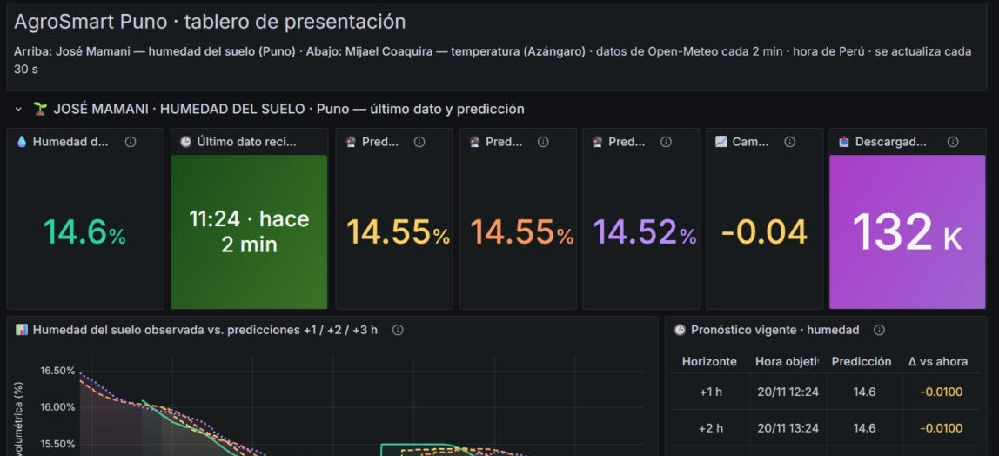

# Pruebas y evidencias

## Pruebas automáticas (sin Docker)
`python -m unittest discover -s pruebas -v` ejecuta **27 pruebas**: contratos y normalización de la API, simuladores (humedad y temperatura), interpolación de 2 minutos, reglas de negocio (umbrales), y las de **no regresión de configuración** (`test_hardening.py`: salud, orden de arranque, secretos, puertos, variables, dashboard, cuadernos y navegación de MkDocs). También corren en CI en cada `push`.

## Evidencias de ejecución (se generan al correr el sistema)
| Evidencia | Qué demuestra | Dónde queda |
|---|---|---|
| Capturas con **reloj del sistema y usuario visibles**, sin recortar | Autoría y momento real del trabajo | PDF/informe |
| `docker ps` con `(healthy)` y `up -d --wait` con código 0 | Servicios listos | Captura |
| Manifiestos de **dos corridas** y su comparación | Qué cambió y por qué | `pyspark/sesiones/U3_Integracion/evidencias/` |
| Compuerta fallando a propósito | La ejecución se detiene con el nombre de lo que falta | Cuaderno U3, sección 6 |
| Prometheus devolviendo **el valor recién publicado** | Observabilidad confirmada | Cuaderno U3, sección 4 |
| `metricas_modelo*.csv`, `resumen_u1*.json`, `evidencia_u2*.json` | Resultados de cada integrante | Carpetas `resultados`, `artifacts`, `evidencias` |
| Tablero Grafana completo | BI de ambas dimensiones y DataOps | Captura única |

### Las dos corridas del 17/11/2026 (`20261117T061131Z`)
- `manifiesto_..._FALLA.json`: la compuerta **PLAUSIBILIDAD: latencia p50 < 60 s** falló en humedad y temperatura. La latencia se midió sobre **las últimas 24 h**, que mezclan el *replay* y las lecturas horarias de la API, publicadas mucho después de la hora del evento (p50 ≈ 748 s y p95 ≈ 30 658 s en humedad). Por eso esa "latencia" (ingesta − fecha del evento) no mide el flujo vivo.
- `manifiesto_....json`: se corrigió **qué** se mide, no el umbral. Se mantuvo 60 s y se limitó la ventana a **los últimos 30 min de eventos en vivo**; ahí la compuerta pasa.
- Se conservan **ambos** manifiestos a propósito: muestran que la compuerta detiene la ejecución y que la corrección está justificada.

> Las **cifras de rendimiento** (RMSE, MAE, latencia p50/p95) salen de tu corrida y se completan en la [pregunta central](proyecto-sello/pregunta-general.md); no se inventan.

## Tablero de presentación en vivo (20-nov-2026, 11:25)

Último dato recibido, predicciones a +1, +2 y +3 h y registros descargados de la API (131 767 por dimensión). Ejecución completa del 20-nov: 6 de 6 cuadernos en OK; corrida U3 `20261120T060237Z` con 24/24 compuertas. Ver también [Big Data histórico](big-data-historico.md) y el [cumplimiento del producto U3](proyecto-sello/u3-producto.md).
