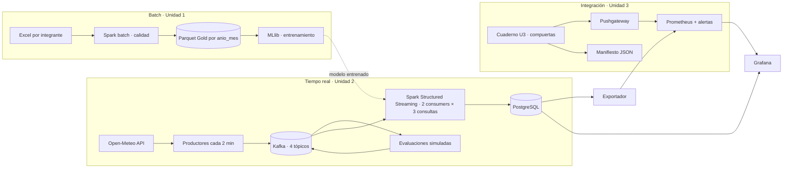
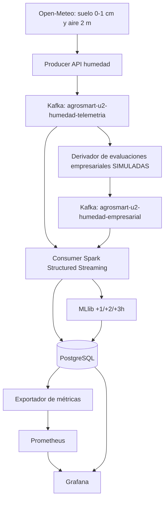

# AgroSmart Puno — Documentación completa (José: humedad · Mijael: temperatura)

> Archivo generado a partir de `docs/` en el orden del menú de MkDocs (19-nov-2026). La versión navegable está publicada en https://jose2207.github.io/papasmart-bigdata/


---
<!-- index.md -->
## AgroSmart Puno · Proyecto Sello Big Data (Unidades 1, 2 y 3)

**Pregunta central:** ¿cómo anticipar a corto plazo las condiciones meteorológicas de riesgo agrícola del altiplano de Puno —estrés hídrico del suelo y heladas— a partir de datos de Open-Meteo? ([detalle](proyecto-sello/pregunta-general.md))

**Equipo y dimensiones** (cada una con DimensiónU1 batch y DimensiónU2 streaming):
- **José Armando Mamani Poccohuanca** — *humedad del suelo* (predicción a +1, +2 y +3 h).
- **Mijael Yurins Coaquira Justo** — *temperatura exterior en Azángaro* (predicción a +1 h con alerta de helada).

Este sitio adopta la navegación del [repositorio del docente](https://github.com/262bigdata/lambda26) con una implementación propia de S1 a S12. Consulta la **matriz de cumplimiento** y las **evidencias** antes de presentar el proyecto.

No se usan sensores físicos, datos de ventas ni otras dimensiones. Tanto la humedad del suelo 0–1 cm como la humedad relativa del aire provienen de **Open-Meteo** (modelos). Los eventos de evaluación empresarial de humedad son **simulados**; no son riegos reales ni recomendaciones agronómicas.

### Ruta de lectura

1. [Pregunta central y dimensiones](proyecto-sello/pregunta-general.md)
2. [Brief oficial completado](proyecto-sello/brief.md)
3. [Datos: real, simulado e inyectado](datos.md)
4. [Arquitectura](arquitectura.md)
5. **José** — DimensiónU1 (S1–S5): [índice](unidad1/index.md) · DimensiónU2 (S6–S12): menú lateral
6. **Mijael** — [índice](mijael/index.md) · [DimensiónU1](mijael/dimension-u1.md) · [DimensiónU2](mijael/dimension-u2.md)
7. [Matriz de rúbrica U2](proyecto-sello/u2-producto.md) y [Evidencias S12](proyecto-sello/u2-evidencias.md)
8. [Guía de ejecución en CMD](guia-ejecucion.md)

**Estado:** sistema completo de las tres unidades, levantado y verificado en la laptop del equipo (19 contenedores, flujo cada 2 minutos en vivo). El [informe del proyecto](informe-proyecto.md) reúne las 14 secciones pedidas; las evidencias están en [pruebas y evidencias](pruebas-evidencias.md).

### Producto final (Unidad 3)
Sistema Big Data **end-to-end** (batch + streaming + BI/ML + observabilidad) para el riesgo agroclimático del altiplano de Puno, con DataOps verificable y hardening.
**Curso:** Big Data · Universidad Peruana Unión, Juliaca · 2026-2 · Grupo 11 · Sección GU
**Repositorio:** [https://github.com/jose2207/papasmart-bigdata](https://github.com/jose2207/papasmart-bigdata) · **Este sitio:** [https://jose2207.github.io/papasmart-bigdata/](https://jose2207.github.io/papasmart-bigdata/)
**Integrantes:** Jose Armando Mamani Poccohuanca (humedad) y Mijael Yurins Coaquira Justo (temperatura).
Ver [instalación](instalacion.md), [uso](uso.md), [matriz de trazabilidad](proyecto-sello/matriz-trazabilidad.md), [DataOps](dataops.md), [hardening](hardening.md) y [demo](demo.md).


---
<!-- informe-proyecto.md -->
## Informe del proyecto · AgroSmart Puno (Producto Final, Unidad 3)

Informe con las 14 secciones de la Tabla 5 de la rúbrica del producto final. Las cifras salen de los cuadernos, de `resultados/`, de los manifiestos (última ejecución integrada: `20261120T014730Z`, 19-nov-2026 20:47 hora de Perú) y de `evidencias/verificacion_ultima.txt`. No hay cifras estimadas presentadas como medidas.

### 1. Portada

| | |
|---|---|
| **Proyecto** | AgroSmart Puno: monitoreo y predicción a corto plazo del riesgo agroclimático del altiplano (humedad del suelo y heladas) |
| **Curso** | Big Data · Universidad Peruana Unión, Juliaca · semestre 2026-2 |
| **Sección / grupo** | GU · Grupo 11 |
| **Integrantes** | Jose Armando Mamani Poccohuanca (humedad del suelo) · Mijael Yurins Coaquira Justo (temperatura exterior) |
| **Docente** | Ing. Abel Ángel Sullón Macalupú |
| **Repositorio** | [github.com/jose2207/papasmart-bigdata](https://github.com/jose2207/papasmart-bigdata) |
| **Documentación** | [jose2207.github.io/papasmart-bigdata](https://jose2207.github.io/papasmart-bigdata/) |

### 2. Resumen del proyecto

En el altiplano de Puno las heladas y el estrés hídrico del suelo dañan los cultivos, y quien vigila el campo necesita saber no solo cómo están la temperatura y la humedad ahora, sino cómo estarán en las próximas horas. AgroSmart Puno es un sistema Big Data de arquitectura **Lambda** que combina un histórico procesado por lotes con datos que llegan en tiempo real. En la capa batch (U1), Spark limpia el histórico de cada integrante, lo deja en Parquet particionado y entrena modelos con MLlib. En la capa de velocidad (U2), un productor consulta **Open-Meteo**, publica un evento cada 2 minutos en **Kafka** y **Spark Structured Streaming** lo procesa con ventanas, watermark y checkpoints, guarda en PostgreSQL y predice la humedad del suelo a +1, +2 y +3 h y la temperatura a +1 h con alerta de helada. **Prometheus** y **Grafana** muestran el estado del pipeline y las predicciones en un tablero en dos partes. En la U3 se integra todo con salud de servicios, compuertas de calidad, manifiesto por corrida, auditoría de configuración, CI y documentación en MkDocs. El modelo de temperatura supera a la persistencia (1,23 °C frente a 1,64 °C); el de humedad no, y se reporta así.

### 3. Competencia y alcance

| Competencia | Cómo se evidencia |
|---|---|
| **CE042** · diseña e implementa arquitecturas Big Data | Arquitectura Lambda con Kafka, Spark batch y Structured Streaming, PostgreSQL, Prometheus y Grafana en Docker; batch y streaming integrados en un solo sistema |
| **CE043** · aplica analítica y aprendizaje automático | MLlib: 5 modelos en U1 (humedad) y 4 en U1 (temperatura); 4 algoritmos × 3 horizontes (humedad) y 4 algoritmos (temperatura) en U2, siempre contra la persistencia |
| **CE044** · comunica resultados para decisiones | Tablero Grafana en dos partes con KPI, predicción y alertas; matriz de trazabilidad; documentación publicada y sustentación |

**Alcance:** humedad volumétrica del suelo 0–1 cm (Puno) y temperatura a 2 m (Azángaro), histórico y tiempo real, predicción a corto plazo, eventos de negocio simulados, observabilidad, costos en S/ y despliegue local reproducible.
**Fuera del alcance:** sensores físicos, otras variables (lluvia, viento, radiación), dosis de riego, alertas oficiales, alta disponibilidad y nube.

### 4. Matriz de trazabilidad

**Variable:** condiciones meteorológicas de riesgo agrícola en el altiplano de Puno. **Pregunta central:** ¿cómo anticipar a corto plazo las condiciones de riesgo agrícola del altiplano de Puno —estrés hídrico del suelo y heladas— a partir de datos de Open-Meteo?

| Integrante · dimensión | Indicador U1 (batch) | Indicador U2 (streaming) | Fuente y técnica | Evidencia |
|---|---|---|---|---|
| José · humedad del suelo | Humedad histórica limpia y humedad esperada por regresión | Humedad en vivo y predicción a +1, +2 y +3 h | U1: Excel → Spark (−999, nulos, duplicados) → Parquet por `anio_mes` → MLlib (Ridge) · U2: Open-Meteo → Kafka → Structured Streaming → regresión lineal | U1: RMSE 0,90 pp, R² 0,974 · U2: RMSE 1,21 / 1,83 / 2,35 pp (persistencia 1,15 / 1,69 / 2,11) · en vivo +1 h (n = 400): MAE 0,125 frente a 0,079 pp |
| Mijael · temperatura exterior | Mín/máx/media diaria, horas ≤ 0 °C y temperatura esperada a +1 h | Temperatura en vivo, predicción a +1 h y alerta de helada | U1: Excel simulado → Spark (imputación con respaldo, lag/lead) → Parquet → MLlib (lineal con lags) · U2: Open-Meteo → Kafka → Structured Streaming → árbol de decisión | U1: RMSE 0,92 °C (persistencia 1,50) · U2: RMSE 1,23 °C (persistencia 1,64) · en vivo +1 h (n = 400): MAE 1,14 frente a 1,48 °C (−22 %) |
| Común · integración y DataOps | Parquet Gold de ambos verificado | Compuertas, latencia p50/p95, error en producción, manifiesto | Cuaderno U3, Pushgateway/Prometheus, auditoría, CI | 24/24 compuertas (19-nov) · latencia p50 7,0 s y 3,1 s; p95 17,6 s y 12,5 s · 9/9 métricas confirmadas en Prometheus |

### 5. Problema y datos

**Necesidad:** anticipar en horas la humedad del suelo (estrés hídrico) y la temperatura (heladas) para vigilar el campo a tiempo. **Usuario:** técnico agrícola o gestor de riego que lee el tablero.

| Conjunto | Contenido | Naturaleza (`origen`) |
|---|---|---|
| `AgroSmart_Humedad_U1.xlsx` | Suelo 0–1 cm (1 439 h), aire 2 m (1 469 filas), suelo 1–3 cm | Real modelado de Open-Meteo + fallas inyectadas (−999, nulos, 30 duplicados) + una hoja simulada |
| `AgroSmart_Temperatura_U1.xlsx` | 2 880 h (120 días) + respaldo (2 905 filas) | Simulado calibrado al altiplano + 30 errores −999, 15 nulos y 25 duplicados inyectados |
| Carga inicial U2 | 90 días por integrante (2 160 lecturas cada uno) | `simulado_carga_inicial` |
| API Open-Meteo | `soil_moisture_0_to_1cm`, `relative_humidity_2m`, `temperature_2m` | `open_meteo_modelado` (estimación de modelo, no sensor) |
| Flujo cada 2 min | Interpolación lineal de las estimaciones horarias | `open_meteo_interpolado_2min` (1 261 lecturas por dimensión al 19-nov) |

**Almacenamiento:** Parquet particionado por `anio_mes` (batch) y PostgreSQL 16 con 10 tablas (streaming, predicciones, ventanas, métricas, costos e integración); la base pesa 16 MB.

### 6. Arquitectura Big Data

Arquitectura **Lambda**: hace falta el histórico (describir y entrenar) y el tiempo real (inferir y alertar). El modelo se entrena por lotes y se aplica en el streaming sin reentrenar.



| Servicio | Imagen | Puerto local |
|---|---|---|
| Kafka (KRaft, volumen persistente) · Kafka UI · Kafka exporter | `apache/kafka:4.0.2` · `kafbat/kafka-ui:v1.5.0` · `kafka-exporter:v1.10.0` | 49093 · 48086 · 49309 |
| PostgreSQL · Jupyter (PySpark 3.5) | `postgres:16-alpine` · imagen propia | 15432 · 4489 |
| Consumers Spark (humedad y temperatura) | imagen propia (`spark-submit`) | — |
| Prometheus · Pushgateway · exportador · Grafana | `prometheus:v3.3.1` · `pushgateway:v1.9.0` · propio · `grafana:11.5.2` | 9095 · 9096 · 9202 · 3300 |

### 7. Procesamiento batch

| Paso | Humedad (José) | Temperatura (Mijael) |
|---|---|---|
| Bronze | 1 439 filas de suelo | 2 880 filas |
| Calidad | 25 errores −999 descartados, 30 duplicados resueltos con `Window + row_number` | 30 errores −999 y 15 nulos; 45 valores imputados con la fuente de respaldo; 25 duplicados |
| Silver/Gold | 1 392 filas (47 descartadas) | 2 880 filas |
| Parquet | `anio_mes` = 2026-09, 10, 11 | `anio_mes` = 2026-07 a 11 |
| Modelo | 5 regresiones + ablación; **Ridge**: RMSE 0,90 pp, MAE 0,53, R² 0,974 frente a 5,59 pp de la línea base | 4 regresiones con lags y hora, división cronológica; **Lineal**: RMSE 0,92 °C, R² 0,970 frente a 1,50 °C de la persistencia; versión desplegable en U2: 0,97 °C |

Decisión de calidad: el −999 es un código de error y **no se imputa** en humedad (se descarta), porque inventar el objetivo sesgaría el modelo; en temperatura existe una fuente de respaldo independiente y por eso sí se imputa, marcando `imputada = true`.

### 8. Ingesta y streaming

- **Tópicos:** `agrosmart-u2-humedad-telemetria`, `…-humedad-empresarial`, `…-temperatura-telemetria`, `…-temperatura-empresarial` (offset 1 333 en los cuatro al 19-nov).
- **Contrato:** JSON Schema por tópico en `uso-agrosmart/contratos`; `evento_id` determinista (hash) para idempotencia; `fecha_evento` con zona horaria; `origen` en cada evento.
- **Spark Structured Streaming:** dos consumers persistentes (`spark-submit`), cada uno con tres consultas: telemetría + inferencia, evaluación empresarial y ventanas de 1 h con watermark de 2 h. Cada consulta tiene su checkpoint; `ON CONFLICT` en PostgreSQL hace idempotentes los reintentos.
- **Decisión de negocio:** cada lectura genera una evaluación (`revision_manual` / `seguimiento` en humedad con umbral didáctico de 20 %; riesgo de helada en temperatura con umbral de 0 °C). Al 19-nov: 1 347 y 1 263 evaluaciones.
- **Tiempo del evento:** se usa la hora del dato, no la de llegada. En la corrida del 19-nov la diferencia entre emisión y evento es de 1 s (humedad) y 120 s (temperatura).

### 9. Observabilidad y costos

**Métricas:** el exportador publica conteos, heartbeat, duración del microlote y retraso por consulta; Prometheus las raspa cada 15 s y evalúa 10 reglas de alerta (consumer detenido, heartbeat > 120 s, microlote > 10 s, lag > 30, integración obsoleta o con falla). **Tablero:** Grafana v4 en tres partes: humedad (José), temperatura (Mijael) y operación común (salud, DataOps, costos).

**Recursos medidos (`docker stats`, 19-nov):** cada consumer Spark usa ≈1 GiB de RAM y 17–20 % de CPU; Kafka ≈1 GiB; el resto menos de 450 MiB.

**Costos (S/, escenarios didácticos, `costos_pen.py`):** con una tarifa de S/ 0,30 por hora de cómputo, mantener el streaming encendido cuesta **S/ 216 al mes** (720 h); el almacenamiento es despreciable (≈388 B por evento: 172 800 eventos al mes ocupan 0,2 GB, S/ 0,08). El batch paga por corrida y el streaming por hora encendida; escalar se justifica cuando el microlote se acerca al disparador o el lag no baja.

### 10. Resultados BI/ML

| Dimensión | Modelo elegido (validación) | RMSE prueba | Persistencia | Lectura |
|---|---|---|---|---|
| Humedad +1 h | Regresión lineal | 1,21 pp | 1,15 pp | no la supera |
| Humedad +2 h | Regresión lineal | 1,83 pp | 1,69 pp | no la supera |
| Humedad +3 h | Regresión lineal | 2,35 pp | 2,11 pp | no la supera |
| Temperatura +1 h | Árbol de decisión | 1,23 °C | 1,64 °C | **−25 %** |

**Error en producción (cuaderno U3, últimas 24 h, cada predicción +1 h comparada con la lectura real de su hora objetivo, n = 400 por dimensión):** humedad MAE 0,125 pp frente a 0,079 pp de la persistencia; temperatura MAE **1,14 °C frente a 1,48 °C (−22 %)**. La verificación SQL independiente da el mismo orden con RMSE: humedad 0,137 frente a 0,126 pp y temperatura 1,82 frente a 1,87 °C.

**Lectura honesta:** la humedad del suelo cambia muy poco entre horas, así que repetir el último valor es muy difícil de superar; el sistema la monitorea y proyecta, pero el modelo no aporta frente a la persistencia. En temperatura el modelo sí aporta y la alerta de helada funciona en vivo.

### 11. Integración y DataOps

- **Comprobación de salud:** healthcheck en 9 servicios y `depends_on: service_healthy`.
- **Configuración fuera del código:** `.env` (no versionado) y `.env.example` documentado.
- **Ejecución integrada:** cuaderno `U3_Integracion_DataOps_S13_S14.ipynb` con 24 compuertas en 3 etapas (10 previas, 10 de calidad y plausibilidad, 4 de streaming), publicación en Pushgateway y confirmación en Prometheus.
- **Manifiesto:** JSON por corrida con versiones, huellas SHA-256 de la configuración, compuertas, KPI y duración; fila en `ejecuciones_integracion`.
- **Corridas registradas** (`pyspark/sesiones/U3_Integracion/evidencias/`):

| Corrida | Compuertas | Latencia p50 hum / temp | p95 hum / temp | Error +1 h en vivo (modelo vs persistencia) | Estado |
|---|---|---|---|---|---|
| 17-nov `…FALLA` | 18/20 | 748 / 762 s | 30 658 / 30 672 s | — | FALLA en calidad (la ventana de 24 h incluía el replay) |
| 17-nov `…061131Z` | 24/24 | 6,3 / 5,8 s | 124 / 138 s | hum 0,58 vs 0,02 · temp 0,63 vs 0,62 (n = 4, horas desalineadas por el desfase de 5 h) | ADVERTENCIA |
| **19-nov `20261120T014730Z`** | **24/24** | **7,0 / 3,1 s** | **17,6 / 12,5 s** | hum 0,125 vs 0,079 · temp **1,14 vs 1,48** (n = 400) | ADVERTENCIA (la humedad no supera a la persistencia) |

  **Prueba de no regresión:** después de la corrección de hora, las 24 compuertas siguen en OK, el flujo procesa filas nuevas y Prometheus confirma las 9 métricas; cambian la latencia y el error, como es esperable en un flujo en vivo. La compuerta que falla a propósito (sección 6 del cuaderno) detiene la ejecución con el nombre de la dependencia ausente.
- **Bitácora de revisión técnica:** 9 hallazgos con causa, corrección y prueba en [hardening](hardening.md). El más importante: las predicciones se guardaban con 5 h de desfase. Se midió (18 001 s), se corrigió el código, se repararon 1 346 + 1 262 lecturas y sus predicciones, y la verificación posterior muestra la hora objetivo = evento + h.
- **CI:** GitHub Actions ejecuta las 27 pruebas, la auditoría, `docker compose config` y `mkdocs build --strict`.

### 12. Repositorio y documentación

- **Repositorio:** [https://github.com/jose2207/papasmart-bigdata](https://github.com/jose2207/papasmart-bigdata)
- **MkDocs:** [https://jose2207.github.io/papasmart-bigdata/](https://jose2207.github.io/papasmart-bigdata/) (publicado por GitHub Actions)
- **Topics:** `campus-juliaca`, `semestre-2026-2`, `linea-cdia`, `tipo-ps`, `bigdata`, `seccion-gu`, `grupo-11-agrosmart-puno` y técnicos.
- **Ejecución:** `git clone` → copiar `.env.example` a `.env` → `iniciar_base.bat` → cuadernos U1 y U2 → `iniciar_streaming.bat` / `iniciar_streaming_mijael.bat` → `iniciar_tiempo_real_2min.bat` → `verificar_sistema.bat`.

### 13. Aporte individual

| | José (humedad del suelo) | Mijael (temperatura exterior) |
|---|---|---|
| U1 | Excel real modelado con fallas inyectadas, calidad, Parquet, 5 modelos y ablación | Excel simulado, imputación con respaldo, lag/lead, modelo cronológico |
| U2 | Productor de humedad, consumer Spark propio, 4 algoritmos × 3 horizontes, Parte 1 del tablero | Productor de temperatura, consumer Spark propio, 4 algoritmos, alerta de helada, Parte 2 del tablero |
| Decisión propia | **Medir contra la persistencia y aceptar el resultado negativo:** gana honestidad y una línea base clara; cuesta mostrar un modelo que no mejora | **Entrenar solo con las variables que el streaming tiene (sin lags):** gana un modelo desplegable sin estado; cuesta precisión (0,92 → 0,97 °C en U1) |

### 14. Limitaciones, riesgos aceptados y mejoras

**Limitaciones:** datos modelados de Open-Meteo, no sensores; carga inicial y U1 de Mijael simulados; el flujo de 2 min es interpolado; la humedad no supera a la persistencia; un solo nodo; umbrales y costos didácticos.

**Riesgos aceptados:** Kafka sin autenticación y con un broker (laboratorio local); credenciales de laboratorio en `.env`; `kafka-ui` y `kafka-exporter` sin healthcheck; un nodo Spark por consumer. Cada uno tiene su plan para producción en [hardening](hardening.md).

**Mejoras priorizadas:**

1. Agregar a la humedad el último valor observado como variable, o predecir el cambio. *Métrica:* RMSE en vivo menor que la persistencia en los tres horizontes.
2. Llevar la temperatura a +2 y +3 h. *Métrica:* mejora frente a la persistencia en cada horizonte.
3. Conectar un ESP32 con sensor capacitivo de suelo al mismo contrato. *Métrica:* lecturas con `origen = sensor` en el tablero.
4. Programar la ejecución integrada a diario. *Métrica:* la alerta «integración obsoleta» no se activa.


---
<!-- instalacion.md -->
## Instalación o ejecución

### Requisitos
- Windows con **Docker Desktop** (Engine running), 8 GB de RAM recomendados y conexión a internet (Open-Meteo y conector Spark-Kafka de Maven en la primera corrida).
- Git (opcional) y un navegador.

### Configuración (credenciales fuera del código)
1. Descomprime el proyecto y abre CMD en su raíz.
2. Copia `.env.example` a `.env` y escribe tus propias claves (`POSTGRES_PASSWORD`, `GRAFANA_ADMIN_PASSWORD`, `JUPYTER_TOKEN`). El `.env` **no se versiona**.
3. Verifica la sintaxis de Compose:
```bat
docker compose --env-file .env -f kafka/compose.yml config -q
docker compose --env-file .env -f pyspark/compose.yml -f pyspark/compose.kafka.yml config -q
```

### Arranque con esperas por salud
```bat
docker compose --env-file .env -f kafka/compose.yml up -d --wait
docker compose --env-file .env -f pyspark/compose.yml -f pyspark/compose.kafka.yml up -d --build --wait postgres jupyter
docker compose --env-file .env -f uso-agrosmart/compose.yml --profile herramientas run --rm inicializar-topicos
docker compose --env-file .env -f obs/compose.yml up -d --build --wait
```
`--wait` espera a que cada servicio con `healthcheck` esté **sano** (no solo arrancado). Atajos: `iniciar_base.bat`, `iniciar_streaming.bat`, `iniciar_streaming_mijael.bat`, `iniciar_tiempo_real_2min.bat`.

La guía completa, paso a paso y con la solución de problemas, está en [Guía de ejecución en CMD](guia-ejecucion.md).


---
<!-- guia-ejecucion.md -->
## GUÍA DE EJECUCIÓN EN CMD — AgroSmart Puno (José: humedad · Mijael: temperatura · U1 + U2)

Todo se ejecuta en **CMD de Windows** (o PowerShell) **desde la raíz de esta carpeta** (donde está `.env`).
Requisito: Docker Desktop abierto ("Engine running"), internet (Open-Meteo y descarga del conector Spark-Kafka).

### 0. Antes de empezar (una sola vez)
1. Descomprime el ZIP, por ejemplo en `D:\C9\Big Data\AgroSmart_Puno_BigData_COMPLETO`.
2. **Usa las MISMAS claves de tu proyecto anterior.** Abre `.env` (notepad .env) y copia ahí `POSTGRES_PASSWORD`, `GRAFANA_ADMIN_PASSWORD` y `JUPYTER_TOKEN` que ya usabas.
   > Si cambias `POSTGRES_PASSWORD`, la base que ya existe en el volumen de Docker **rechazará** la conexión. Si es un proyecto nuevo, pon cualquier clave.
3. Verifica Docker:
```bat
cd /d "D:\C9\Big Data\AgroSmart_Puno_BigData_COMPLETO"
docker compose version
docker info
docker compose --env-file .env -f kafka/compose.yml config -q
docker compose --env-file .env -f pyspark/compose.yml -f pyspark/compose.kafka.yml config -q
```
(`config -q` no imprime nada si todo está bien.) Si el proyecto anterior ocupa los mismos puertos: `docker compose stop` **desde su carpeta** (no uses `down -v`).

### 1. UNIDAD 1 (batch) — solo Jupyter
```bat
docker compose --env-file .env -f pyspark/compose.yml -f pyspark/compose.kafka.yml up -d --build postgres jupyter
```
* Jupyter: http://localhost:4489/lab (token = `JUPYTER_TOKEN`)  ·  Spark UI: http://localhost:4041 (aparece al crear la SparkSession)
* Abre `U1_Batch_Humedad/U1_AgroSmart_S01_S05_Humedad_Batch.ipynb` y ejecuta **de arriba a abajo** (S1→S5).
* Los datos (Excel + CSV) ya están en `U1_Batch_Humedad/data/`. Para regenerarlos: `python generar_datos_u1.py` (opcional).

### 2. UNIDAD 2 (tiempo real) — orden estricto
**Paso 1 — Kafka (+ Kafka UI y exporter)**
```bat
docker compose --env-file .env -f kafka/compose.yml up -d
docker compose --env-file .env -f kafka/compose.yml ps
```
Kafka UI: http://localhost:48086

**Paso 2 — Crear los 2 tópicos**
```bat
docker compose --env-file .env -f uso-agrosmart/compose.yml --profile herramientas run --rm inicializar-topicos
```

**Paso 3 — Abre el cuaderno U2** `Sensorhumedad/U2_AgroSmart_S06_S12_Humedad_Tiempo_Real.ipynb` y ejecuta:
sección 0 → **Sesión 06** → **Sesión 07** (API + **carga inicial simulada**) → **sección 10.1** (entrenar modelos 1/2/3 h; solo la primera vez, antes de arrancar el consumer).
> El consumer de Spark **no arranca si faltan los modelos** (`modelos/humedad_1h|2h|3h`): por eso se entrena antes.

**Paso 4 — Streaming (S6 + S8 + tiempo real)**
```bat
docker compose --env-file .env -f pyspark/compose.yml -f pyspark/compose.kafka.yml --profile streaming up -d spark-consumer
docker compose --env-file .env -f uso-agrosmart/compose.yml --profile flujo up -d producer-evaluaciones
docker compose --env-file .env -f uso-agrosmart/compose.yml --profile replay run --rm producer-api-replay
docker compose --env-file .env -f uso-agrosmart/compose.yml --profile continuo up -d producer-api-continuo
```
* La primera vez `spark-consumer` descarga el conector de Maven: espera unos minutos.
* Debe iniciar **3 consultas**: `telemetria`, `empresarial`, `ventanas`.

**Paso 5 — Observabilidad y Grafana (S9/S11)**
```bat
docker compose --env-file .env -f obs/compose.yml up -d --build
```
| Qué | URL |
|---|---|
| Grafana (dashboard v4, 3 partes, 61 paneles) | http://localhost:3300 → Dashboards → AgroSmart U2 → rango por defecto **últimas 24 h + 4 h de pronóstico** (cámbialo a 7 o 90 días para ver la historia) |
| Prometheus Targets | http://localhost:9095/targets |
| Exportador PostgreSQL | http://localhost:9202/metrics |
| Exportador Kafka | http://localhost:49309/metrics |
| Kafka UI | http://localhost:48086 |
| MkDocs (opcional) | http://localhost:8008 |

Continúa en el cuaderno en orden: **Sesión 08** (consumer y **monitor en tiempo real 8.3**), **Sesión 09**, **Sesión 10** (entrenamiento e inferencia a 3 h), **Sesión 11** y (Mijael) **Sesión 12**.


### 2-bis. DIMENSIÓN DE MIJAEL (temperatura, Azángaro) — mismo Docker, tópicos y tablas propias
Requisitos: Kafka y Jupyter arriba (secciones 1 y 2, pasos 1–2; `inicializar-topicos` ya crea los 4 tópicos).

**DimensiónU1 (batch):** en Jupyter abre `U1_Batch_Temperatura/U1_Mijael_Temperatura_S01_S05_Batch.ipynb` y ejecútalo de arriba a abajo. Datos simulados en `U1_Batch_Temperatura/data/AgroSmart_Temperatura_U1.xlsx` (regenerar: `python generar_datos_u1_temperatura.py`).

**DimensiónU2 (streaming), orden estricto:**
1. Cuaderno `Sensortemperatura/U2_Mijael_Temperatura_S06_S12_Tiempo_Real.ipynb`: Paso 0 → 1 → **2** (API + carga inicial) → **3** (entrenar +1 h).
2. Streaming:
```bat
docker compose --env-file .env -f pyspark/compose.yml -f pyspark/compose.kafka.yml --profile streaming-temperatura up -d spark-consumer-temperatura
docker compose --env-file .env -f uso-agrosmart/compose.yml --profile flujo-temperatura up -d producer-evaluaciones-temperatura
docker compose --env-file .env -f uso-agrosmart/compose.yml --profile replay-temperatura run --rm producer-temp-replay
docker compose --env-file .env -f uso-agrosmart/compose.yml --profile continuo-temperatura up -d producer-temp-continuo
```
3. Grafana común (http://localhost:3300): fila **«07 · MIJAEL · TEMPERATURA»**, rango *Last 180 days*.
4. Verificar llegada de datos:
```bat
docker compose --env-file .env -f pyspark/compose.yml -f pyspark/compose.kafka.yml logs -f spark-consumer-temperatura
docker compose --env-file .env -f uso-agrosmart/compose.yml logs -f producer-temp-continuo
docker compose --env-file .env -f uso-agrosmart/compose.yml --profile verificacion-temperatura run --rm consumer-verificacion-temp
docker compose --env-file .env -f uso-agrosmart/compose.yml --profile verificacion-temperatura run --rm consumer-verificacion-empresa-temp
docker compose --env-file .env -f pyspark/compose.yml exec postgres psql -U agrosmart -d agrosmart_u2 -c "SELECT origen, COUNT(*), MAX(fecha_evento) FROM eventos_temperatura GROUP BY origen;"
docker compose --env-file .env -f pyspark/compose.yml exec postgres psql -U agrosmart -d agrosmart_u2 -c "SELECT estado, COUNT(*) FROM eventos_empresariales_temperatura GROUP BY estado;"
```
5. Pruebas S8: evento tardío `--profile pruebas-temperatura run --rm producer-evento-tardio-temperatura` (en `uso-agrosmart/compose.yml`) y reinicio del consumer con `stop` / `up -d spark-consumer-temperatura`.

> **RAM:** dos consumers Spark (humedad y temperatura) más Jupyter exigen memoria. Si Docker Desktop va justo (menos de ~8 GB), detén uno mientras demuestras el otro: `docker compose --env-file .env -f pyspark/compose.yml -f pyspark/compose.kafka.yml stop spark-consumer` (o `spark-consumer-temperatura`).
> Atajo: `iniciar_streaming_mijael.bat`.

### 2-ter. DATOS CADA 2 MINUTOS (José y Mijael a la vez)
Open-Meteo solo entrega estimaciones **horarias** de modelo (y la humedad del suelo no existe a menor resolución); no hay una API pública gratuita con humedad del suelo observada cada 2 min para Puno/Azángaro. El productor de 2 minutos consulta Open-Meteo (caché de 10 min) e **interpola linealmente entre las dos horas que rodean cada instante**; cada evento queda marcado `origen = open_meteo_interpolado_2min` (**no es un sensor**).
```bat
:: (con Kafka, los consumers de Spark y los modelos ya entrenados)
docker compose --env-file .env -f uso-agrosmart/compose.yml --profile tiempo-real-2min up -d producer-humedad-2min producer-temperatura-2min
docker compose --env-file .env -f uso-agrosmart/compose.yml logs -f producer-humedad-2min producer-temperatura-2min
:: detener
docker compose --env-file .env -f uso-agrosmart/compose.yml --profile tiempo-real-2min stop
```
Usa estos servicios **en lugar de** `producer-api-continuo` y `producer-temp-continuo`. Atajo: `iniciar_tiempo_real_2min.bat`. Para datos realmente observados cada 2 min haría falta un sensor físico (p. ej. ESP32 + sensor capacitivo de suelo y DS18B20) publicando a Kafka.

### 3. CÓMO VER LLEGAR LOS DATOS DE JOSÉ (en CMD)
```bat
:: Logs en vivo (Ctrl+C para salir, no detiene el contenedor)
docker compose --env-file .env -f pyspark/compose.yml -f pyspark/compose.kafka.yml logs -f spark-consumer
docker compose --env-file .env -f uso-agrosmart/compose.yml logs -f producer-api-continuo
docker compose --env-file .env -f uso-agrosmart/compose.yml logs --tail=40 producer-evaluaciones

:: Mensajes crudos en Kafka (5 de cada tópico)
docker compose --env-file .env -f uso-agrosmart/compose.yml --profile verificacion run --rm consumer-verificacion
docker compose --env-file .env -f uso-agrosmart/compose.yml --profile verificacion run --rm consumer-verificacion-empresa

:: Conteos en PostgreSQL
docker compose --env-file .env -f pyspark/compose.yml exec postgres psql -U agrosmart -d agrosmart_u2 -c "SELECT origen, COUNT(*), MAX(fecha_evento) FROM eventos_telemetria GROUP BY origen;"
docker compose --env-file .env -f pyspark/compose.yml exec postgres psql -U agrosmart -d agrosmart_u2 -c "SELECT horizonte_h, COUNT(*), SUM(CASE WHEN es_retro THEN 1 ELSE 0 END) retro FROM predicciones_humedad GROUP BY 1 ORDER BY 1;"

:: Estado de contenedores y recursos
docker ps
docker stats --no-stream
```
En el cuaderno (U2, Sesión 08, sección **8.3**) hay un **monitor en tiempo real**: cada evento de Kafka con su offset y la predicción que guardó Spark.

### 4. Pruebas S8 (opcionales, para sustentar)
```bat
:: Evento tardío (watermark)
docker compose --env-file .env -f uso-agrosmart/compose.yml --profile pruebas run --rm producer-evento-tardio
:: Checkpoint: reiniciar el consumer sin duplicados
docker compose --env-file .env -f pyspark/compose.yml -f pyspark/compose.kafka.yml stop spark-consumer
docker compose --env-file .env -f pyspark/compose.yml -f pyspark/compose.kafka.yml --profile streaming up -d spark-consumer
:: Pruebas unitarias sin Docker (necesita Python)
python -m unittest discover -s pruebas -v
```

### 5. Apagar sin perder evidencias
```bat
docker compose --env-file .env -f uso-agrosmart/compose.yml --profile flujo --profile continuo --profile flujo-temperatura --profile continuo-temperatura --profile tiempo-real-2min stop
docker compose --env-file .env -f obs/compose.yml stop
docker compose --env-file .env -f pyspark/compose.yml -f pyspark/compose.kafka.yml --profile streaming --profile streaming-temperatura stop
docker compose --env-file .env -f kafka/compose.yml stop
```
**Nunca uses `down -v`** si quieres conservar PostgreSQL, Kafka y Grafana. Atajos: `iniciar_base.bat`, `iniciar_streaming.bat` (José), `iniciar_streaming_mijael.bat`, `iniciar_tiempo_real_2min.bat`, `detener_todo.bat`.

### 6. Problemas frecuentes
| Síntoma | Causa / solución |
|---|---|
| `password authentication failed` | La clave del `.env` no coincide con la del volumen existente de PostgreSQL. Usa la clave anterior. |
| `network agrosmart-jose-kafka-net ... not found` | Primero levanta Kafka (Paso 1). |
| `ClassNotFoundException KafkaSourceProvider` / error Maven | Falta internet al descargar el conector; reintenta `up -d spark-consumer`. |
| `spark-consumer` se detiene: *falta modelos* | Ejecuta la sección 10.1 (Sesión 10) del cuaderno U2 (José: `modelos/humedad_*`; Mijael: `modelos/temperatura_1h`) primero. |
| Faltan tablas `*_temperatura` en una base ya existente | Ejecuta el Paso 0 del cuaderno U2 de Mijael o reinicia `spark-consumer-temperatura` (ambos aplican `schema_temperatura.sql`). |
| Puerto ocupado | Detén el proyecto anterior con `docker compose stop` en su carpeta. |
| Grafana vacío | Rango **Last 180 days**; confirma datasource PostgreSQL y que hay filas (sección 3). |
| No llegan eventos nuevos | La API entrega 1 dato por hora y el productor evita repetidos: no es una caída de Kafka. |


---
<!-- uso.md -->
## Uso del sistema

| Paso | Qué hacer | Dónde |
|---|---|---|
| 1 | Levantar la base (Kafka, PostgreSQL, Jupyter, tópicos) | [Instalación](instalacion.md) |
| 2 | **DimensiónU1** de cada integrante: ejecutar el cuaderno batch de arriba a abajo | Jupyter `http://localhost:4489/lab` |
| 3 | **DimensiónU2**: carga inicial + entrenamiento (Pasos 0–3 del cuaderno U2) | Jupyter |
| 4 | Arrancar consumers Spark y productores (flujo cada 2 min) | `iniciar_streaming*.bat`, `iniciar_tiempo_real_2min.bat` |
| 5 | Ver los datos llegar y las predicciones | Grafana `http://localhost:3300` (filas 01–08), Kafka UI `:48086` |
| 6 | **Ejecución integrada** con compuertas y manifiesto | Cuaderno `U3_Integracion_DataOps_S13_S14.ipynb` |
| 7 | Auditoría de configuración y pruebas | `python scripts/auditoria_config.py` · `python -m unittest discover -s pruebas -v` |

Casos de uso: el técnico agrícola consulta el tablero y ve la **humedad del suelo** y la **temperatura** actuales, su predicción a corto plazo y las alertas didácticas (humedad baja, helada).


---
<!-- arquitectura.md -->
## Arquitectura de extremo a extremo



### Equivalencia con `lambda26`

| Docente | AgroSmart Puno | Función |
|---|---|---|
| `kafka/` | `kafka/` | Broker, UI y Kafka Exporter |
| `pyspark/` | `pyspark/` | Jupyter batch + consumer Spark persistente |
| `obs/` | `obs/` | Prometheus, alertas, Grafana |
| `uso-atmos/` | `uso-agrosmart/` | Producer Open-Meteo, derivador empresarial y consumers de prueba |
| `docs/` | `docs/` | MkDocs, brief, rúbrica, evidencias por sesión |
| `.github/workflows/` | `.github/workflows/` | Publicación del sitio en GitHub Pages |

### Contrato de datos

`agrosmart-u2-humedad-telemetria`: `evento_id`, `fecha_evento` (UTC), `ubicacion`, `humedad_suelo_m3m3`, `humedad_suelo_pct`, `humedad_aire_pct`, `origen`, `modo_publicacion`, `emitido_utc`. Se calcula `humedad_suelo_pct = humedad_suelo_m3m3 × 100`. La humedad relativa del aire ya llega en `%`. Los contratos exactos están en `uso-agrosmart/contratos`.

`agrosmart-u2-humedad-empresarial`: cada telemetría produce una evaluación simulada `revision_manual` o `seguimiento`. El umbral 20 % solo permite mostrar un flujo empresarial reproducible; no equivale a una recomendación agronómica real.

### Semántica streaming

El consumer Spark utiliza **tres consultas** con checkpoints distintos. `telemetria` deduplica por `evento_id` con watermark 2 horas; `empresarial` deduplica eventos de evaluación; `ventanas` agrega humedad del suelo y aire por ventanas de 1 hora, watermark 2 horas y modo `update`. En PostgreSQL, `ON CONFLICT` permite reintentos idempotentes de los mismos identificadores.

Las métricas de Kafka y Spark no son idénticas: un offset confirma publicación, no procesamiento o persistencia. El progreso debe acreditarse con tabla y logs. En Kafka de un nodo y Spark `local[2]` hay procesamiento distribuido local de Spark, no alta disponibilidad ni clúster multinodo.

### Segunda dimensión (Mijael · temperatura) sobre la misma infraestructura
Mismo patrón Lambda y mismos servicios (Kafka, Spark, PostgreSQL, Prometheus, Grafana), con **tópicos, tablas, modelo y consumer propios**:

```
Open-Meteo temperature_2m (Azángaro) → producer_api_temperatura → Kafka agrosmart-u2-temperatura-telemetria
   → spark-consumer-temperatura (temp_telemetria · temp_empresarial · temp_ventanas) → PostgreSQL *_temperatura → Grafana (fila 07)
Evaluaciones de riesgo de helada → Kafka agrosmart-u2-temperatura-empresarial
```


---
<!-- modulos.md -->
## Módulos o funcionalidades

| Módulo | Funcionalidad | Problema que resuelve | Dueño |
|---|---|---|---|
| Batch Spark (U1) | Lectura, calidad (−999, nulos, duplicados), Parquet particionado, modelo base | Histórico confiable para describir y entrenar | José (humedad) · Mijael (temperatura) |
| Ingesta Kafka (S6–S7) | Productores de la API, evaluaciones simuladas, flujo cada 2 min, contratos JSON | Eventos en vivo con idempotencia | José · Mijael |
| Streaming Spark (S8) | 3 consultas por integrante: eventos + inferencia, empresarial, ventanas de 1 h (watermark 2 h) | Procesar y predecir al llegar cada dato | José · Mijael |
| Modelos (S10) | 4 algoritmos MLlib vs. persistencia (+1/+2/+3 h humedad; +1 h temperatura) | Anticipar la variable | José · Mijael |
| Observabilidad (S9) | Prometheus, exporter, alertas técnicas, costos en S/ | Saber si el sistema funciona y cuánto cuesta | Común |
| BI en Grafana (S11) | Tablero único: filas 01–06 (humedad), 07 (temperatura), 08 (DataOps) | Una sola historia de riesgo agroclimático | Común |
| DataOps y hardening (U3) | Healthchecks, esperas, compuertas, manifiesto, auditoría, CI | Ejecución verificable y repetible | Común |

El detalle por sesión está en las secciones de cada integrante.


---
<!-- datos.md -->
## Datos: qué es real, qué es simulado y qué es inyectado

| Conjunto | Contenido | Naturaleza | `origen` / etiqueta |
|---|---|---|---|
| `AgroSmart_Humedad_U1.xlsx` · `suelo_0_1cm` | Humedad suelo 0–1 cm, 1439 h | **Real modelado** (Open-Meteo) + **fallas inyectadas** (−999, nulos) | — |
| · `aire_2m` | Humedad aire, 1469 filas | Real modelado + nulos + **30 duplicados inyectados** | — |
| · `suelo_1_3cm_sim` | Suelo 1–3 cm | **Simulado** a partir del objetivo | — |
| `simulado_carga_inicial.csv` | 90 días horarios antes del histórico API | **Simulado** (`simulador_humedad.py`, semilla 42) | `simulado_carga_inicial` |
| `historico_open_meteo.csv` | ≈60 días horarios | **Real modelado** | `open_meteo_modelado` |
| Tiempo real | Última hora publicada por la API cada 10 min | **Real modelado** | `open_meteo_modelado` |

### Reglas de calidad (U1)
1. `−999` es código de error: se **descarta** la fila (no se imputa).
2. Nulo en el **objetivo**: se descarta. Nulo en **aire**: se descarta para el modelo.
3. Duplicados por `fecha_hora`: se conserva la fila con **menos nulos** (`Window + row_number`).
4. Control de dominio: humedad entre 0 y 100 %.

### Reglas de continuidad (U2)
- La simulación termina **1 h antes** del primer dato de la API (sin huecos ni solapes).
- División cronológica 70/15/15 con brecha de *h* filas; **el 15 % final es API real**.
- `es_retro = TRUE` marca predicciones cuyo objetivo ya ocurrió (replay); no se mezclan con las prospectivas al evaluar.


### Dimensión de Mijael (temperatura, Azángaro)
| Conjunto | Contenido | Naturaleza | `origen` |
|---|---|---|---|
| `AgroSmart_Temperatura_U1.xlsx` · `temperatura_2m` | 2880 h (120 días) | **Simulado** (`simulador_temperatura.py`, semilla 11) + **−999 (30) y nulos (15) inyectados** | — |
| · `temperatura_respaldo` | 2905 filas | **Simulado** (sesgo +0.4 °C) + nulos + **25 duplicados** | — |
| `simulado_carga_inicial_temp.csv` | 90 días antes del histórico API | **Simulado** (semilla 7) | `simulado_carga_inicial` |
| `historico_open_meteo_temp.csv` y tiempo real | ≈60 días + última hora cada 10 min | **Real modelado** (`temperature_2m`) | `open_meteo_modelado` |

Reglas U1: −999 y nulos se tratan como faltantes y se **imputan con el respaldo** (`imputada=true`); si ninguna fuente tiene dato, se descarta. Reglas U2: la simulación termina 1 h antes del primer dato de la API; prueba = último 15 % (API real).

### Flujo cada 2 minutos (ambas dimensiones)
| Conjunto | Contenido | Naturaleza | `origen` |
|---|---|---|---|
| Tiempo real cada 2 min | 1 evento cada 2 min por dimensión | **Interpolación lineal** de estimaciones horarias reales de Open-Meteo (no es sensor) | `open_meteo_interpolado_2min` |

Ver [flujo cada 2 minutos](tiempo-real-2-minutos.md).


---
<!-- tiempo-real-2-minutos.md -->
## Flujo de datos cada 2 minutos (humedad y temperatura)

### Por qué no basta con "consultar la API cada 2 minutos"
- **Open-Meteo** entrega estimaciones de **modelo** con paso **horario**. Su resolución de 15 minutos existe solo para pocas variables y en Europa central; la **humedad del suelo** es horaria. Consultar cada 2 min devolvería el mismo valor durante una hora.
- Las APIs que sí publican observaciones cada minuto corresponden a redes de estaciones de otros países (p. ej. Nueva Zelanda o Singapur) o a planes comerciales, y no traen humedad del suelo para Puno/Azángaro. OpenWeather ofrece una línea de tiempo de 1 minuto en One Call 4.0 (con clave), también basada en modelos.
- **Conclusión:** no existe una fuente gratuita de humedad del suelo *observada* cada 2 min para esta zona.

### Solución implementada
`producer_api_2min.py` (un servicio por integrante):
1. Consulta Open-Meteo (ayer + hoy + mañana) y la **cachea 10 min**.
2. Cada 2 min calcula el valor del instante por **interpolación lineal** entre las dos estimaciones horarias consecutivas que lo rodean (`interpolacion_2min.py`).
3. Publica **un evento** en el mismo tópico de telemetría, con `origen = open_meteo_interpolado_2min`, `modo_publicacion = interpolado_2min`, las horas ancla y el peso de interpolación.

| Aspecto | Detalle |
|---|---|
| Idempotencia | `evento_id` determinista por instante; reinicios sin duplicados (`ultimo_2min_*.txt`) |
| Consumers/modelos | Sin cambios; el horizonte (+1/+2/+3 h) se cuenta desde cada evento |
| Honestidad | Reconstrucción determinista; **no** agrega ruido ni variaciones; **no** es medición de sensor |
| Límite | Usa una estimación horaria *posterior* (pronóstico del modelo) como ancla superior |

### Para datos realmente observados cada 2 minutos
Instalar un **sensor físico** (ESP32 + sensor capacitivo de humedad de suelo + DS18B20/DHT22) y publicar a Kafka con el mismo contrato (`origen = sensor_fisico`).

### Comandos
```bat
docker compose --env-file .env -f uso-agrosmart/compose.yml --profile tiempo-real-2min up -d producer-humedad-2min producer-temperatura-2min
docker compose --env-file .env -f uso-agrosmart/compose.yml logs -f producer-humedad-2min producer-temperatura-2min
```


---
<!-- pruebas-evidencias.md -->
## Pruebas y evidencias

### Pruebas automáticas (sin Docker)
`python -m unittest discover -s pruebas -v` ejecuta **27 pruebas**: contratos y normalización de la API, simuladores (humedad y temperatura), interpolación de 2 minutos, reglas de negocio (umbrales), y las de **no regresión de configuración** (`test_hardening.py`: salud, orden de arranque, secretos, puertos, variables, dashboard, cuadernos y navegación de MkDocs). También corren en CI en cada `push`.

### Evidencias de ejecución (se generan al correr el sistema)
| Evidencia | Qué demuestra | Dónde queda |
|---|---|---|
| Capturas con **reloj del sistema y usuario visibles**, sin recortar | Autoría y momento real del trabajo | PDF/informe |
| `docker ps` con `(healthy)` y `up -d --wait` con código 0 | Servicios listos | Captura |
| Manifiestos de **dos corridas** y su comparación | Qué cambió y por qué | `pyspark/sesiones/U3_Integracion/evidencias/` |
| Compuerta fallando a propósito | La ejecución se detiene con el nombre de lo que falta | Cuaderno U3, sección 6 |
| Prometheus devolviendo **el valor recién publicado** | Observabilidad confirmada | Cuaderno U3, sección 4 |
| `metricas_modelo*.csv`, `resumen_u1*.json`, `evidencia_u2*.json` | Resultados de cada integrante | Carpetas `resultados`, `artifacts`, `evidencias` |
| Tablero Grafana completo | BI de ambas dimensiones y DataOps | Captura única |

#### Las dos corridas del 17/11/2026 (`20261117T061131Z`)
- `manifiesto_..._FALLA.json`: la compuerta **PLAUSIBILIDAD: latencia p50 < 60 s** falló en humedad y temperatura. La latencia se midió sobre **las últimas 24 h**, que mezclan el *replay* y las lecturas horarias de la API, publicadas mucho después de la hora del evento (p50 ≈ 748 s y p95 ≈ 30 658 s en humedad). Por eso esa "latencia" (ingesta − fecha del evento) no mide el flujo vivo.
- `manifiesto_....json`: se corrigió **qué** se mide, no el umbral. Se mantuvo 60 s y se limitó la ventana a **los últimos 30 min de eventos en vivo**; ahí la compuerta pasa.
- Se conservan **ambos** manifiestos a propósito: muestran que la compuerta detiene la ejecución y que la corrección está justificada.

> Las **cifras de rendimiento** (RMSE, MAE, latencia p50/p95) salen de tu corrida y se completan en la [pregunta central](proyecto-sello/pregunta-general.md); no se inventan.


---
<!-- dataops.md -->
## DataOps / DevOps aplicado

| Práctica | Cómo se aplica | Verificación |
|---|---|---|
| **Comprobación de salud** | `healthcheck` en Kafka, PostgreSQL, Jupyter, exporter, Prometheus, Pushgateway, Grafana y los dos consumers Spark (heartbeat en `metricas_pipeline`) | `docker ps` → `(healthy)` |
| **Espera por dependencia** | `depends_on` con `condition: service_healthy` (Grafana→Prometheus→exporter, Kafka UI y exporter→Kafka, Jupyter y consumers→PostgreSQL); `up -d --wait` | `scripts/auditoria_config.py` |
| **Configuración fuera del código** | Todo por `${VARIABLE}` desde `.env` (no versionado) y `.env.example` documentado; puertos solo en `127.0.0.1` | Auditoría: «Secretos» y «Variables» |
| **Ejecución integrada con compuertas** | Cuaderno `U3_Integracion_DataOps_S13_S14.ipynb`: 10 compuertas previas, compuertas de calidad y plausibilidad, flujo en vivo, publicación y confirmación en Prometheus | Manifiesto + tablero (fila 08) |
| **Manifiesto de ejecución** | JSON con runId, versiones, **huellas SHA-256 de la configuración**, compuertas, KPI y duración; fila en `ejecuciones_integracion` | `evidencias/manifiesto_<runId>.json` |
| **CI** | GitHub Actions: pruebas, auditoría, `compose config` y `mkdocs --strict` | Pestaña Actions |

**KPI con percentiles:** latencia del pipeline = `fecha_ingesta − emitido_utc` sobre el flujo vivo (24 h). Se publican **p50** y **p95**; la compuerta de plausibilidad usa el **p50 (< 60 s)** y el p95 (> 300 s) es **advertencia**. Nunca solo el promedio.


---
<!-- hardening.md -->
## Hardening y revisión técnica final

### Lista de comprobación aplicada (`scripts/auditoria_config.py`)
| Punto | Pregunta | Resultado |
|---|---|---|
| Versión de las imágenes | ¿Versión exacta, no `latest`? | Cumple |
| Reinicio | ¿Qué hace el contenedor si cae? | Cumple (`restart: unless-stopped`) |
| Salud | ¿Hay forma automática de saber si está **listo**? | Cumple (9 servicios permanentes) |
| Orden de arranque | ¿Espera a que su dependencia esté sana? | Cumple (`service_healthy`) |
| Secretos | ¿Hay credenciales escritas en el archivo? | Cumple (`${VARIABLE}`; `.env` ignorado) |
| Superficie expuesta | ¿Qué puertos se publican? | Cumple (11 puertos, todos en `127.0.0.1`) |
| Variables | ¿Están documentadas en `.env.example`? | Cumple |

### Bitácora de hallazgos y corrección
| # | Hallazgo | Corrección | Prueba de corrección |
|---|---|---|---|
| 1 | Ningún servicio declaraba si estaba listo; las dependencias esperaban solo a que arrancara | `healthcheck` + `service_healthy` | Auditoría «Salud» y «Orden» = Cumple; `up -d --wait` |
| 2 | Pushgateway aislado de Jupyter y sin `honor_labels` | Red de datos + `honor_labels: true` | Prometheus devuelve el valor recién publicado |
| 3 | Sin registro auditable de cada corrida integrada | Tabla `ejecuciones_integracion`, manifiesto, métricas y alertas | Dos corridas comparadas con `comparar()` |
| 4 | Variables de Mijael sin documentar | Agregadas a `.env.example` | Auditoría «Variables» = Cumple |
| 5 | **Predicciones desfasadas 5 h:** PySpark entrega los timestamps a Python sin zona horaria (hora local del contenedor, `TZ=America/Lima`) y el consumer los etiquetaba como UTC; la hora objetivo quedaba antes del propio evento y todo salía `es_retro = true`. El error en vivo del manifiesto del 17-nov comparaba horas distintas | Función `hora_peru()` en ambos consumers (fecha con zona −05:00), conexión PostgreSQL con `TimeZone=America/Lima`, PostgreSQL y Grafana en hora de Perú y `pyspark/sql/reparar_hora_peru.sql` (mide el desfase y solo corrige si es de 5 h) | `scripts/verificacion.sql`: desfase emisión−evento en segundos; objetivo = evento + h; `es_retro = f` en vivo; nueva ejecución integrada comparada con la anterior |
| 6 | El consumer de verificación rechazaba el tópico de temperatura (`choices` solo de humedad) y leía desde el offset 0 | Acepta los 4 tópicos, lee los últimos N mensajes y muestra la humedad del **suelo** como variable principal | `verificar_sistema.bat`, sección 4 |
| 7 | `.gitignore` excluía evidencias, resultados y modelos que la documentación presenta como verificables | Se versionan (pesan menos de 1 MB); siguen fuera `.env`, checkpoints, `bronze/` y `.spark-ivy/` | `git ls-files` en el repositorio |
| 8 | Tablero con tablas desbordadas y métricas de Spark de ambos integrantes mezcladas | Dashboard v4 en 3 partes (humedad → temperatura → común), tablas a ancho completo, Prometheus filtrado por consulta | `test_hardening` (paneles e ids únicos) y revisión visual |
| 9 | Logs con sufijos `-2min-1`/`-1` y ruido `py4j` que dificultaban la demo | `container_name` fijo y `py4j` en `WARNING` | Logs de la demo |

### Prueba de no regresión
Tras **cada cambio**: `python -m unittest discover -s pruebas -v` (27 pruebas) + `python scripts/auditoria_config.py` + **repetir la ejecución integrada** y comparar manifiestos. Cambia lo esperable (latencia, error del modelo: la fuente es en vivo); sería **regresión** que una compuerta pase de OK a FALLA o que el flujo procese cero filas.

### Riesgos aceptados
| Riesgo | Por qué se acepta | Qué cambiaría en producción |
|---|---|---|
| Kafka `PLAINTEXT`, 1 broker, sin autenticación | Laboratorio local; puertos en `127.0.0.1` | TLS + SASL, ≥ 3 brokers |
| Credenciales de laboratorio en `.env` y token de Jupyter simple | Equipo local; `.env` no versionado | Gestor de secretos y acceso autenticado |
| Sin healthcheck en `kafka-ui` y `kafka-exporter` | Imagen mínima; el exporter se observa desde Prometheus | Sondas desde el orquestador |
| Datos modelados, simulados e interpolados | No hay API gratuita con humedad del suelo observada cada 2 min | Sensores físicos al mismo contrato |
| Un nodo Spark por consumer | Volumen bajo | Clúster con checkpoints compartidos |
| Umbrales y costos didácticos | Demostran el flujo de decisión | Validación con agrónomo y tarifas reales |


---
<!-- demo.md -->
## Demo end-to-end reproducible (10 minutos)

| Min. | Qué muestras | Comando o URL | Qué debe verse | Plan alternativo |
|---|---|---|---|---|
| 0–1 | Entorno sano | `docker ps` | Servicios `(healthy)` | Captura con fecha y hora |
| 1–2 | Compuertas previas | Cuaderno U3, sección 1 | 10 × OK | Manifiesto anterior |
| 2–4 | Flujo cada 2 min de ambos | `logs -f producer-humedad-2min producer-temperatura-2min` y Kafka UI | Offsets creciendo | Salida guardada |
| 4–5 | Batch: KPI p50/p95 y Gold | Cuaderno U3, sección 2 | p50 frente a p95 | Captura de 2.1 |
| 5–7 | Streaming, predicción y error en producción | Sección 3 y Grafana filas 01–08 | Filas nuevas y error | Captura del tablero |
| 7–8 | Prometheus confirma lo publicado | Sección 4 | devuelto = publicado | Consulta en `:9095` |
| 8–9 | Manifiestos de dos corridas | Sección 5 | Tabla esperable / regresión | JSON abierto |
| 9–10 | Hardening | `python scripts/auditoria_config.py` | Todos «Cumple/Aceptado» | Salida guardada |

**Antes de empezar:** verifica que los productores estén publicando (los offsets crecen). Toda captura de respaldo debe tener fecha y hora visibles. Otra persona puede repetir la demo siguiendo la [guía de ejecución](guia-ejecucion.md).


---
<!-- equipo.md -->
## Equipo y aporte individual

| Integrante | Dimensión | DimensiónU1 (batch) | DimensiónU2 (streaming) | Evidencia verificable |
|---|---|---|---|---|
| **Jose Armando Mamani Poccohuanca** | Humedad del suelo (Puno) | Excel real modelado + fallas inyectadas; calidad, Parquet, 5 modelos y ablación | Humedad en vivo; predicción +1, +2 y +3 h; consumer Spark propio; tablero filas 01–06 | Cuadernos, `metricas_modelo.csv`, commits |
| **Mijael Yurins Coaquira Justo** | Temperatura exterior (Azángaro) | Excel simulado; imputación con respaldo; lag/lead; modelo cronológico | Temperatura en vivo; predicción +1 h con alerta de helada; consumer Spark propio; tablero fila 07 | Cuadernos, `metricas_modelo_temperatura.csv`, commits |

**Común al grupo** (se presenta una sola vez; cada integrante responde sobre ello): arquitectura, DataOps, hardening, documentación, demo y repositorio ([DataOps](dataops.md), [hardening](hardening.md), [demo](demo.md)).

Cada integrante demuestra además **una decisión propia, con lo que gana y lo que cuesta** (láminas de la sustentación): José, *medir contra la persistencia y aceptar un resultado negativo*; Mijael, *entrenar con las variables que el streaming sí tiene (sin lags)*.


---
<!-- repositorio.md -->
## Repositorio y estándares

```
AgroSmart_Puno_BigData_COMPLETO/
├─ docs/ · MkDocs (documentación publicada)           ├─ obs/ · Prometheus, exporter, Grafana (dashboard único)
├─ kafka/ · broker, Kafka UI, exporter                ├─ pruebas/ · unitarias y de no regresión
├─ pyspark/ · Jupyter, consumers, SQL, sesiones/      ├─ scripts/ · auditoría de configuración
├─ uso-agrosmart/ · productores, contratos, 2 min     └─ .github/workflows/ · CI y publicación de docs
```

### Estándares
- **Repositorio:** [https://github.com/jose2207/papasmart-bigdata](https://github.com/jose2207/papasmart-bigdata) · **MkDocs publicado:** [https://jose2207.github.io/papasmart-bigdata/](https://jose2207.github.io/papasmart-bigdata/)
- **Topics del repositorio:** `campus-juliaca`, `semestre-2026-2`, `linea-cdia`, `tipo-ps`, `bigdata`, `seccion-gu`, `grupo-11-agrosmart-puno`, `apache-kafka`, `spark-streaming`, `pyspark`, `grafana`, `prometheus`, `open-meteo`.
- **Una rama por sesión cerrada** y commits coherentes con las evidencias (las fechas de las capturas deben coincidir con el historial).
- **Sin secretos:** `.env` en `.gitignore`; `.env.example` solo con marcadores.
- **CI** (`.github/workflows/ci.yml`): pruebas, auditoría de configuración, validación de Compose y `mkdocs build --strict`.
- **Reproducibilidad:** `git status` limpio tras ejecutar el sistema; la guía de ejecución se sigue sin ayuda.


---
<!-- limitaciones.md -->
## Limitaciones y mejoras

### Limitaciones
- Los datos son **modelados** (Open-Meteo), **simulados** (carga inicial; U1 de Mijael) o **interpolados** (flujo cada 2 min); no hay sensores físicos.
- La humedad del suelo cambia poco entre horas: la **persistencia** es un rival fuerte y **en esta corrida el modelo no la supera**. RMSE de prueba (pp) de la regresión lineal frente a la persistencia: **+1 h 1.21 vs 1.15 · +2 h 1.83 vs 1.69 · +3 h 2.35 vs 2.11** (`resultados/metricas_modelo.csv`). Se reporta como **resultado negativo** y no se oculta: el valor del flujo está en el monitoreo y en la tendencia, no en ganarle a la persistencia. En cambio, el modelo de temperatura sí la supera: **1.23 °C vs 1.64 °C** (−25 %).
- Un solo nodo (sin alta disponibilidad); Kafka con un broker y sin autenticación (riesgo aceptado, ver [hardening](hardening.md)).
- Umbrales (20 % de humedad, 0 °C de helada) y costos en S/ son **didácticos**; no hay alertas oficiales ni dosis de riego.
- Cada integrante usa una zona distinta (Puno y Azángaro); las une la variable de interés.

### Mejoras priorizadas
1. Conectar un **sensor físico** (ESP32 + sensor capacitivo de suelo y DS18B20) al mismo contrato de Kafka.
2. Validar los modelos contra observaciones reales y recalibrar umbrales con un agrónomo.
3. Volumen y TLS/SASL en Kafka, y secretos en un gestor.
4. Pruebas de carga y clúster Spark con checkpoints compartidos.
5. Automatizar la ejecución integrada (programación diaria) con alerta si el manifiesto envejece.


---
<!-- proyecto-sello/pregunta-general.md -->
## Pregunta central, variable de interés y dimensiones del equipo

> Redacción propuesta siguiendo el brief oficial de lambda26 (sección 2 y 3). Si el docente fijó otra formulación, cámbiala aquí y en `brief.md` manteniendo la estructura: **1 pregunta central → 1 variable de interés → 1 dimensión por integrante, medida con un indicador U1 (batch) y uno U2 (streaming)**.

### Pregunta central del proyecto (hilo conductor único)
**¿Cómo anticipar a corto plazo las condiciones meteorológicas de riesgo agrícola del altiplano de Puno —estrés hídrico del suelo y heladas— a partir de datos de Open-Meteo?**

### Variable de interés
**Condiciones meteorológicas de riesgo agrícola en el altiplano de Puno.** Se dimensiona en sus componentes medibles: la **humedad del suelo** (estrés hídrico) y la **temperatura exterior** (heladas). Todas las dimensiones convergen en **un solo tablero de Grafana**.

### Dimensiones, indicadores e instrumentos
| Integrante | Dimensión | **DimensiónU1** · indicador batch (sin tiempo real) | **DimensiónU2** · indicador streaming (con tiempo real) | Fuente batch (U1) | Fuente streaming (U2) |
|---|---|---|---|---|---|
| **Jose Armando Mamani Poccohuanca** | **Humedad del suelo** (0–1 cm; humedad del aire como complemento) — *¿qué humedad del suelo se espera en Puno 1, 2 y 3 h después?* | Humedad histórica limpia (Parquet) y **humedad esperada** por un modelo de regresión sobre el histórico (foto fija) | Humedad en vivo y **predicción a +1, +2 y +3 h** actualizándose dato por dato | Excel `AgroSmart_Humedad_U1.xlsx` (real modelado + fallas inyectadas + 1 hoja simulada) | API Open-Meteo `soil_moisture_0_to_1cm` + `relative_humidity_2m` → Kafka |
| **Mijael Yurins Coaquira Justo** | **Temperatura exterior** — *¿qué temperatura exterior se espera en la zona de referencia de Azángaro una hora después, a partir de los datos meteorológicos de Open-Meteo?* | Temperatura mín./máx./media diaria y **horas de helada**; **temperatura esperada a +1 h** por regresión sobre el histórico (foto fija) | Temperatura en vivo y **predicción a +1 h** con **alerta de helada** | Excel `AgroSmart_Temperatura_U1.xlsx` (**simulado**) | API Open-Meteo `temperature_2m` → Kafka |

Cada integrante construye y defiende **sus dos capas** (batch y streaming); ambos usan el mismo patrón Lambda y la misma infraestructura (Kafka, Spark, PostgreSQL, Prometheus, Grafana) con tópicos, tablas, modelos y consumers **propios**.

### Cómo se combinan en el tablero final
Una sola historia: **riesgo agroclimático del altiplano = helada (temperatura, Mijael) + estrés hídrico (humedad del suelo, José)**. En Grafana: filas 01–06 de José y fila 07 de Mijael, en el mismo dashboard.
*Nota de coherencia:* la dimensión de José usa la zona de referencia de **Puno** (−15.84, −70.02) y la de Mijael **Azángaro** (−14.91, −70.19); las une la variable de interés (altiplano de Puno), no el mismo punto. Si el docente exige una sola zona, basta cambiar `AGRO_LAT/AGRO_LON` o `TEMP_LAT/TEMP_LON` en el `.env`.

### Criterio para dar por respondida la pregunta central
1. **DimensiónU1 (ambos):** histórico validado (conteos Spark = pandas), Parquet particionado y modelo batch comparado contra persistencia.
2. **DimensiónU2 (ambos):** flujo Kafka → Spark → PostgreSQL → Grafana funcionando, con 3 consultas por integrante, sin duplicados, observable (Prometheus) y con costos en S/.
3. **Predicción:** cada modelo se compara con la persistencia sobre **datos reales** y se reporta el resultado **tal como salga**, incluso si no la supera.
4. Se declaran las limitaciones (datos modelados o simulados, sin validación con sensores físicos).

### Resultados (completar tras ejecutar — no se inventan)
| Integrante | Indicador | Dónde se obtiene | Valor |
|---|---|---|---|
| José | Filas Bronze→Silver, −999, duplicados; mejor modelo U1 vs. baseline; ablación | `U1_Batch_Humedad/artifacts/resumen_u1.json` | 1 439 → 1 392 filas (47 descartadas), 25 errores −999, 30 duplicados; **Ridge** RMSE 0,90 pp, R² 0,974 frente a 5,59 pp de la línea base (promedio) |
| José | Ganador, RMSE/MAE/R² y persistencia en +1/+2/+3 h | `Sensorhumedad/resultados/metricas_modelo.csv` | Regresión lineal: RMSE 1,21 / 1,83 / 2,35 pp frente a 1,15 / 1,69 / 2,11 de la persistencia — **no la supera** (resultado negativo reportado) |
| Mijael | Filas, −999, imputadas con respaldo; mejor modelo U1 vs. persistencia | `U1_Batch_Temperatura/artifacts/resumen_u1_temperatura.json` | 2 880 filas, 30 errores −999, 45 imputadas con respaldo, 25 duplicados; **Lineal con lags** RMSE 0,92 °C frente a 1,50 °C de la persistencia |
| Mijael | Ganador, RMSE/MAE/R² y persistencia en +1 h | `Sensortemperatura/resultados/metricas_modelo_temperatura.csv` | **Árbol de decisión**: RMSE 1,23 °C, R² 0,934 frente a 1,64 °C de la persistencia (−25 %) |
| Ambos | Conteos simulado / API / predicciones | `evidencias/evidencia_u2*.json` y `evidencias/verificacion_ultima.txt` | Ver [informe](../informe-proyecto.md), sección 10 |

**Conclusión:** la pregunta central se responde **parcialmente**. Para las **heladas**, el modelo de temperatura a +1 h supera a la persistencia (1,23 °C frente a 1,64 °C) y la alerta ≤ 0 °C funciona en vivo. Para el **estrés hídrico**, la humedad del suelo cambia tan poco entre horas que repetir el último valor es más exacto que el modelo (1,21 frente a 1,15 pp a +1 h); el sistema la monitorea y la proyecta, pero no mejora a la persistencia. Los datos son modelados (Open-Meteo) y parcialmente simulados.

### Limitaciones
Open-Meteo es **estimación de modelo**, no sensor; la carga inicial es **simulada**; en U1 de José una hoja se deriva del objetivo y **todo el U1 de Mijael es simulado**; un solo nodo; el suelo cambia poco entre horas; umbrales (20 % de humedad, 0 °C de helada) y costos en S/ son **didácticos**; no se estiman dosis de riego ni alertas oficiales.


---
<!-- proyecto-sello/brief.md -->
## Brief técnico-analítico — AgroSmart Puno (plantilla oficial lambda26, completada)

### 1. Datos del equipo
- **Nombre del equipo:** AgroSmart Puno · **Grupo:** 11 · **Sección:** GU · **Curso:** Big Data (2026-2, Juliaca)
- **Repositorio (URL):** [https://github.com/jose2207/papasmart-bigdata](https://github.com/jose2207/papasmart-bigdata) · **Documentación publicada:** [https://jose2207.github.io/papasmart-bigdata/](https://jose2207.github.io/papasmart-bigdata/)
- **Topics del repositorio configurados:** sí — `campus-juliaca`, `semestre-2026-2`, `linea-cdia`, `tipo-ps`, `bigdata`, `seccion-gu`, `grupo-11-agrosmart-puno`, `apache-kafka`, `spark-streaming`, `pyspark`, `grafana`, `prometheus`, `open-meteo`
- **Integrantes:**

| Integrante | Rol o énfasis previsto |
|---|---|
| Jose Armando Mamani Poccohuanca | Humedad del suelo; énfasis en batch/Spark y BI/ML |
| Mijael Yurins Coaquira Justo | Temperatura exterior; énfasis en streaming/Kafka y observabilidad |

(Énfasis de coordinación; cada integrante construye de extremo a extremo su dimensión con sus indicadores U1 y U2.)

### 2. Dominio del proyecto
- **Nombre:** AgroSmart Puno — riesgo agroclimático del altiplano.
- **Problema (2–4 líneas):** en el altiplano de Puno las **heladas** y el **estrés hídrico del suelo** afectan los cultivos. Se necesita observar en continuo la temperatura y la humedad del suelo y anticipar su valor en las horas siguientes para apoyar la vigilancia agroclimática.
- **Dominio de datos:** agroclimatología / IoT-meteorología; se mide temperatura a 2 m y humedad volumétrica del suelo 0–1 cm (y humedad relativa del aire).
- **Variable de interés:** condiciones meteorológicas de riesgo agrícola en el altiplano de Puno.
- **Pregunta central:** ¿cómo anticipar a corto plazo las condiciones meteorológicas de riesgo agrícola del altiplano de Puno —estrés hídrico del suelo y heladas— a partir de datos de Open-Meteo?
- **Usuarios / actores:** técnico agrícola o gestor de riego/vigilancia (lee el tablero), y el sistema de alertas didáctico.
- **Arquitectura prevista:** **Lambda**, porque se necesita histórico (descripción y entrenamiento) **y** tiempo real (inferencia y alerta); el modelo entrenado en batch se despliega en streaming (criterio S1, 2.5.1).
- **Fuente batch:** Excel/CSV por integrante (`AgroSmart_Humedad_U1.xlsx`: Open-Meteo real modelado + fallas inyectadas + hoja simulada; `AgroSmart_Temperatura_U1.xlsx`: simulado calibrado al clima del altiplano). Es un dataset realista, **no** medición de sensores físicos.
- **Fuente de eventos en tiempo real:** API Open-Meteo (modelada), publicada a Kafka como evento horario; **carga inicial simulada** previa de 90 días por integrante.
- **¿Misma fuente en batch y streaming?** Sí en espíritu: el mismo origen (Open-Meteo) visto como lectura en vivo (U2) y como acumulación histórica (U1).
- **¿Continúa un proyecto anterior?** Continúa el proyecto AgroSmart Puno U2 del propio equipo.

### 3. Dimensiones de análisis y fuentes previstas
Tabla de asignación (detalle en [pregunta central y dimensiones](pregunta-general.md)):

| Integrante | Dimensión | Indicador U1 (batch) | Indicador U2 (streaming) | Fuente batch | Fuente streaming |
|---|---|---|---|---|---|
| Jose A. Mamani P. | Humedad del suelo | Humedad histórica y humedad esperada (regresión, foto fija) | Humedad en vivo y predicción +1/+2/+3 h | Excel humedad | API `soil_moisture_0_to_1cm` → Kafka |
| Mijael Y. Coaquira J. | Temperatura exterior (Azángaro) | Mín/máx/media diaria, horas de helada y temperatura esperada +1 h | Temperatura en vivo y predicción +1 h con alerta de helada | Excel temperatura | API `temperature_2m` → Kafka |

#### Dimensión: Humedad del suelo (integrante: Jose Armando Mamani Poccohuanca)
- **Relación con la pregunta central:** componente *estrés hídrico* del riesgo agroclimático.
- **Decisión que habilita:** priorizar la revisión de parcelas cuando la humedad esperada baje de un umbral didáctico (20 %).
- **Indicador U1:** ¿cuánta humedad del suelo explican aire y hora, y qué humedad cabe esperar? Métrica: RMSE/MAE/R² frente a baseline; humedad esperada por el modelo.
- **Modelo U1:** regresión (Lineal, Ridge, Elastic Net, RF, GBT), una sola vez; ablación sin la variable simulada.
- **Fuente batch:** Excel (hojas `suelo_0_1cm`, `aire_2m`, `suelo_1_3cm_sim`; clave `fecha_hora`).
- **Salida U1:** cuaderno `U1_AgroSmart_S01_S05_Humedad_Batch.ipynb`.
- **Indicador U2:** humedad del suelo en vivo y su valor a +1, +2 y +3 h.
- **Modelo U2:** series de tiempo (4 algoritmos × 3 horizontes) comparado con persistencia, corriendo en Spark Structured Streaming.
- **Fuente streaming:** tópico `agrosmart-u2-humedad-telemetria` (evento_id, fecha_evento, ubicacion, humedad_suelo_m3m3, humedad_suelo_pct, humedad_aire_pct, origen).
- **Salida U2:** filas 01–06 del Grafana común.
- **Se combina con:** la temperatura (Mijael) en el mismo tablero.
- **Requisitos:** 1) El sistema debe ingerir humedad horaria en Kafka con contrato e idempotencia. 2) El sistema debe procesarla en streaming con ventanas, watermark y checkpoint sin duplicar. 3) El sistema debe predecir +1/+2/+3 h y compararlo con la persistencia.

#### Dimensión: Temperatura exterior (integrante: Mijael Yurins Coaquira Justo)
- **Pregunta de la dimensión:** ¿qué temperatura exterior se espera en la zona de referencia de Azángaro una hora después, a partir de los datos meteorológicos de Open-Meteo?
- **Relación con la pregunta central:** componente *heladas* del riesgo agroclimático.
- **Decisión que habilita:** activar medidas de protección o vigilancia cuando la temperatura prevista cruza 0 °C (umbral didáctico).
- **Indicador U1:** perfil térmico (mín/máx/media diaria, horas bajo 0 °C) y temperatura esperada a +1 h. Métrica: °C y horas de helada; RMSE/MAE/R² frente a persistencia.
- **Modelo U1:** regresión con lags y hora (Lineal, Ridge, RF, GBT), división cronológica, una sola vez; ablación hacia el conjunto desplegable en U2.
- **Fuente batch:** Excel simulado (hojas `temperatura_2m`, `temperatura_respaldo`; clave `fecha_hora`); fallas −999, nulos y duplicados; imputación con el respaldo.
- **Salida U1:** cuaderno `U1_Mijael_Temperatura_S01_S05_Batch.ipynb`.
- **Indicador U2:** temperatura en vivo y proyectada a +1 h, con alerta si cruza ≤ 0 °C.
- **Modelo U2:** series de tiempo (4 algoritmos) frente a persistencia, en Spark Structured Streaming.
- **Fuente streaming:** tópico `agrosmart-u2-temperatura-telemetria` (evento_id, fecha_evento, ubicacion, temperatura_c, origen).
- **Salida U2:** fila 07 del Grafana común.
- **Se combina con:** la humedad del suelo (José) en el mismo tablero.
- **Requisitos:** 1) El sistema debe ingerir temperatura horaria desde Open-Meteo a Kafka. 2) El sistema debe derivar y guardar evaluaciones de riesgo de helada. 3) El sistema debe predecir la temperatura a +1 h en vivo y mostrar la alerta en Grafana.

**Qué SÍ cubre el proyecto:** temperatura y humedad del suelo del altiplano de Puno, Lambda con Kafka/Spark/PostgreSQL/Grafana/Prometheus, predicción a corto plazo, observabilidad y costos en S/.
**Qué NO cubre:** otras variables (lluvia, viento, radiación), sensores físicos, dosis de riego, alertas oficiales, alta disponibilidad, despliegue en nube.
**Unidad 3 (cerrada):** infraestructura compartida (Kafka, Spark, PostgreSQL, Prometheus, Grafana), ejecución integrada con compuertas y manifiesto (S13), hardening y prueba de no regresión (S14). Ver [informe del proyecto](../informe-proyecto.md).

### 4. Aprobación
Docente: ______ · Fecha: ______


---
<!-- proyecto-sello/matriz-trazabilidad.md -->
## Matriz de trazabilidad

Relaciona la **variable** y su **pregunta** con la **dimensión de cada integrante**, sus indicadores **U1 (batch)** y **U2 (streaming)**, el componente y la técnica, y la **evidencia**. Una fila por indicador y por integrante.

**Variable:** condiciones meteorológicas de riesgo agrícola en el altiplano de Puno.
**Pregunta central:** ¿cómo anticipar a corto plazo las condiciones meteorológicas de riesgo agrícola del altiplano de Puno —estrés hídrico del suelo y heladas— a partir de datos de Open-Meteo?

| Nivel | Pregunta | Indicador | Componente y técnica | Evidencia |
|---|---|---|---|---|
| **José · Dimensión: humedad del suelo · U1 (batch)** | ¿Cuánta humedad del suelo explican la humedad del aire y la hora, y qué humedad cabe esperar? | RMSE/MAE/R² del mejor modelo frente al baseline; humedad esperada (foto fija); filas Bronze→Silver, −999 y duplicados | PySpark (lazy evaluation, ventanas, RDD), calidad de datos, Parquet por `anio_mes`, MLlib (Lineal, Ridge, Elastic Net, RF, GBT) y ablación | Cuaderno `U1_AgroSmart_S01_S05_Humedad_Batch.ipynb`; `resumen_u1.json` |
| **José · U2 (streaming)** | ¿Qué humedad del suelo habrá en Puno a +1, +2 y +3 h? | Humedad en vivo; RMSE/MAE/R² por horizonte frente a persistencia (prueba = datos reales de la API) | Kafka (2 tópicos), Spark Structured Streaming (ventana 1 h, watermark 2 h, checkpoints), MLlib series de tiempo (4 algoritmos × 3 horizontes) | Cuaderno U2; `metricas_modelo.csv`; Grafana filas 01–06 |
| **Mijael · Dimensión: temperatura exterior (Azángaro) · U1 (batch)** | ¿Cuántas horas de helada y qué temperatura cabe esperar una hora después? | Mín/máx/media diaria, horas ≤ 0 °C; RMSE/MAE/R² frente a persistencia; imputadas con respaldo | PySpark (lag/lead, ventanas), imputación con fuente de respaldo, Parquet, MLlib con división cronológica y ablación | Cuaderno `U1_Mijael_Temperatura_S01_S05_Batch.ipynb`; `resumen_u1_temperatura.json` |
| **Mijael · U2 (streaming)** | ¿Qué temperatura exterior se espera en Azángaro una hora después? | Temperatura en vivo; predicción +1 h; RMSE frente a persistencia; alerta ≤ 0 °C | Kafka (2 tópicos), Spark Structured Streaming (3 consultas), MLlib 4 algoritmos, evaluaciones de riesgo de helada | Cuaderno U2 de temperatura; `metricas_modelo_temperatura.csv`; Grafana fila 07 |
| **Común · Integración y DataOps** | ¿El sistema completo funciona junto y puede verificarse y repetirse? | Compuertas aprobadas, latencia del pipeline p50/p95, error de predicción en producción, manifiesto | Ejecución integrada con compuertas, Pushgateway/Prometheus, manifiesto JSON, auditoría de configuración | Cuaderno `U3_Integracion_DataOps_S13_S14.ipynb`; Grafana fila 08; [hardening](../hardening.md) |

Cada indicador se contrasta con una **línea base de persistencia** y los resultados se reportan **tal como salgan**. Los datos son modelados (Open-Meteo), parcialmente simulados o interpolados y llevan su etiqueta `origen` ([datos](../datos.md)).


---
<!-- proyecto-sello/u2-producto.md -->
## Producto de Unidad 2 — cumplimiento exigible

**Fuente de requisitos:** [rúbrica oficial U2](https://262bigdata.github.io/lambda26/proyecto-sello/u2-producto/). Esta matriz documenta **qué código existe y qué debe demostrarse**; no adjudica por anticipado la nota A.

| Nº | Peso | Objetivo nivel A | Implementación disponible | Evidencia que falta ejecutar/guardar |
|---|---:|---|---|---|
| 1 Kafka empresarial S6 | 12 % | Publicado/consumido en vivo; contrato y tópico documentados | `producer_evaluaciones.py`, JSON Schema y consumidor Spark/consumer de inspección | Kafka UI + offsets del tópico empresarial y filas PG nuevas |
| 2 IoT/sensores S7 | 10 % | Telemetría integrada y volumen verificado | API Open-Meteo, `producer_api_humedad.py`, tópico y esquema de humedad | 72 eventos de replay/continuo + procedencia visible; aclarar que no son sensores físicos |
| 3 Spark Streaming S8 | 14 % | Ventanas, watermark, checkpoints en vivo | `consumer_streaming.py`: 3 consultas, ventanas 1h, watermark 2h y checkpoints | SQL ventanas, prueba tardío y reinicio sin duplicados |
| 4 Observabilidad S9 | 12 % | Métricas correlacionadas y dashboard operativo | Prometheus, Kafka exporter, PG exporter, alertas, Grafana | `UP`, 3 consultas activas, alertas y screenshots Firing→Normal |
| 5 Costos/escalado S9 | 8 % | Estimación justificada por volumen | `costos_pen.py` con observaciones PG y 3 escenarios en S/ | `docker stats`, tamaño medio, tasas reales y discusión de escalado |
| 6 BI/ML S11 | 12 % | KPIs streaming demostrados en vivo | dashboard Grafana v4 en 3 partes (61 paneles) y 2 fuentes | KPIs de evaluación empresarial e inferencia visibles juntos en el mismo tablero |
| 7 Modelos S10 | 12 % | Modelo validado e integrado BI | Notebook cuatro algoritmos, tres horizontes, baseline, artefactos Spark | RMSE/MAE/R² y métricas prospectivas si las hay, sin afirmar generalización física |
| 8 Sustentación S12 | 20 % | Aporte individual y seis subaspectos | MkDocs, README, guion y estructura GitHub | Demo ante el docente, repo publicado, site MkDocs URL real |

### Sustentación — seis subaspectos obligatorios

1. **Aporte individual:** José ejecuta y explica su dimensión U2; no atribuye código ajeno.
2. **Comunicación y orden:** presenta objetivo, arquitectura, demo y conclusiones con tiempos claros.
3. **Presentación personal:** puntualidad, vestimenta e imagen adecuadas, actitud profesional y respeto según rúbrica.
4. **Repositorio y estándares:** topics académicos, commits, seguridad de secretos, reproducibilidad.
5. **MkDocs:** publicado, navegable y alineado a estas secciones.
6. **Pitch/demo:** breve evolución desde U1 y PowerPoint que precede a la demostración técnica.

**Nota:** el texto de la rúbrica muestra `Σ(Peso × Puntos)/100 ×20`, pese a que la escala A/B/C/D ya es 20/15/10/5. Para una nota sobre 20, la suma ponderada `Σ(Peso × Puntos)/100` es la interpretación dimensionalmente consistente; confirmar con el docente antes de reportar notas.


---
<!-- proyecto-sello/u2-evidencias.md -->
## Bitácora de evidencias S6–S12

Marcar **solo después** de verificar cada prueba. No reemplazar capturas por datos inventados.

| Prueba | Archivo o captura a guardar | Estado (19-nov-2026) |
|---|---|---|
| Kafka empresarial S6 | UI tópico `...empresarial`, mensaje/offset y consumidor de verificación | Verificado: offset 1 333 en `…-empresarial`; 1 347 + 1 263 evaluaciones en PostgreSQL |
| API telemetría S7 | consulta con 2 variables, UTC, número de registros y unidades | Verificado: 3 orígenes etiquetados (simulado, modelado, interpolado 2 min) |
| Kafka IoT S7 | UI tópico `...telemetria`, volumen y offsets | Verificado: offsets 1 333 en los tópicos de telemetría; consumer de verificación |
| Spark S8 | logs de tres consultas activas sin errores + offsets procesados | Verificado: 6 consultas activas (heartbeat) y logs sin errores |
| Watermark S8 | mensaje tardío publicado y consulta SQL de ID descartado (si efectivamente sucede) | Pendiente |
| Checkpoint S8 | tres directorios checkpoint y prueba de reinicio sin duplicados | Verificado: reinicio de los consumers el 19-nov; el batchId siguió numerando desde el checkpoint (975 a las 16:38 → 1029 tras el reinicio) y `evento_id` sigue sin duplicados (compuerta de calidad) |
| Observabilidad S9 | Prometheus Targets UP y series de filas/duración/heartbeat | Verificado: targets UP, series por consulta |
| Alertas S9 | Normal → Pending → Firing → Normal y explicación del disparo | Pendiente |
| Costos S9 | `docker stats`, tabla `escenarios_costos` y archivo `costos_pen.json` en soles | Verificado: `docker stats` en `evidencias/verificacion_ultima.txt` y `costos_pen.json` |
| ML S10 | 12 resultados, 3 ganadores, RMSE/MAE/R², baseline y modelo cargado | Verificado: `metricas_modelo*.csv` y modelos cargados por los consumers |
| Predicción S10 | tabla `predicciones_humedad`, campo `es_retro`, objetivo +1/2/3 | Verificado: objetivo = evento + h, `es_retro = f` en vivo (tras la corrección de hora) |
| BI S11 | un solo screenshot de Grafana con KPI + humedad + predicción | Verificado: dashboard v4 en 3 partes |
| Sustentación S12 | enlace MkDocs, repositorio, commits, topics, PPT y demo individual | Pendiente |

### Protocolo de demo defendible

1. Mostrar JSON de API y señalar que es **modelado**, no sensor físico.
2. Abrir Kafka UI: tópicos y consumer `consumer_verificacion.py` / `consumer_verificacion_empresa.py` con offsets.
3. Mostrar `spark-consumer` persistente con sus tres consultas y checkpoints.
4. Publicar una tanda de replay delante del docente; comprobar nueva llegada a Kafka y persistencia PostgreSQL. Repetir IDs para verificar idempotencia.
5. Mostrar prueba de un evento tardío, esperar progreso y cotejar el ID en SQL.
6. Prometheus Targets UP, dashboard Grafana completo; explicar fechas en replay histórico y campo `es_retro`.
7. Enseñar 12 evaluaciones ML, RMSE/MAE/R², baseline y 3 modelos guardados.
8. Mostrar costos en S/ como escenario, con tasas/mediciones justificadas.
9. Terminar con GitHub y documentación pública; sustentar el aporte individual.

### Dos fortalezas y dos oportunidades para Unidad III

**Fortalezas esperadas a comprobar:** arquitectura modular con producer/consumer independientes; modelos separados con selección temporal y métricas reproducibles. **Siguientes pasos recomendados:** contrastar Open-Meteo con sondas físicas del suelo; ampliar pruebas de despliegue, carga, fallos y monitoreo a volúmenes mayores.


---
<!-- unidad1/index.md -->
## José · DimensiónU1 — Humedad del suelo histórica (batch, S1–S5)

**Dimensión de José:** humedad del suelo (0–1 cm) · **DimensiónU1** = indicador batch ([pregunta central y dimensiones](../proyecto-sello/pregunta-general.md)).
**Cuaderno:** `pyspark/sesiones/U1_Batch_Humedad/U1_AgroSmart_S01_S05_Humedad_Batch.ipynb` · **Datos:** `data/AgroSmart_Humedad_U1.xlsx`.

| Sesión | Tema | Producto | Página |
|---|---|---|---|
| S1 | Arquitectura Lambda/Kappa, batch vs. streaming | Ficha arquitectónica | [S1](s01-arquitectura.md) |
| S2 | Fundamentos PySpark, lazy evaluation | Transformaciones y `explain()` | [S2](s02-pyspark.md) |
| S3 | Calidad de datos y particionamiento | Parquet Gold por `anio_mes` | [S3](s03-calidad.md) |
| S4 | ML distribuido (MLlib, regresión) | Modelo comparado vs. baseline | [S4](s04-mllib.md) |
| S5 | Evaluación de la Unidad I | Resumen y rúbrica | [S5](s05-evaluacion.md) |

Aporta a la **pregunta central** el componente *estrés hídrico*: histórico confiable y baseline. La dimensión de Mijael está en [su sección](../mijael/index.md).


---
<!-- unidad1/s01-arquitectura.md -->
## S1 · Arquitectura Big Data: Lambda y Kappa

**José · DimensiónU1.** Aporte de esta sesión: elige y justifica la arquitectura.

- **5V:** volumen modesto (1 lectura/h), variedad (Excel, CSV, JSON, eventos), velocidad horaria, veracidad limitada (valores modelados), valor (anticipar humedad).
- **Clasificación:** entrenar con histórico y limpiar → *batch*; recibir y predecir cada lectura → *streaming*; Grafana → *serving*.
- **Decisión:** **Lambda** (batch + speed + serving). Solo el **modelo entrenado** cruza del batch al speed layer; el riesgo es el *drift* si ambos calculan distinto (se mitiga con el mismo `PipelineModel`).

```
Open-Meteo / Excel ─► BATCH (PySpark+Parquet+MLlib) ─► modelo ─┐
                  └─► Kafka ─► SPEED (Structured Streaming) ───┴─► PostgreSQL ─► Grafana
```
**Evidencia:** secciones 1.1–1.6 del cuaderno U1 (entorno verificado, clasificación, ficha, reflexión).


---
<!-- unidad1/s02-pyspark.md -->
## S2 · Fundamentos PySpark

**José · DimensiónU1.** Aporte de esta sesión: lectura y transformación eficiente de la humedad.

1. Lectura con **esquema explícito** (`StructType`), no `inferSchema`.
2. **Lazy evaluation:** el plan se construye en milisegundos; la acción (`count`) ejecuta. Se mide ambos tiempos.
3. **`explain(True)`:** *predicate pushdown* y *column pruning* en el plan optimizado/físico.
4. `withColumn` con `to_timestamp`, `when/otherwise`, `lit`, `current_date`.
5. **Agrupaciones** (`groupBy().agg`) por categoría y por hora; **ventana** (`Window`) con media móvil de 3 h sin perder filas.
6. **RDD** `map` + `reduceByKey` (patrón MapReduce) y verificación cruzada con DataFrame; `cache()`.

**Advertencia de dominio:** la humedad es % volumétrico modelado, no mm ni sonda.
**Evidencia:** secciones 2.1–2.10 (capturas de `explain`, tablas y gráfico por hora).


---
<!-- unidad1/s03-calidad.md -->
## S3 · Calidad de datos y particionamiento

**José · DimensiónU1.** Aporte de esta sesión: calidad del dato y capa Gold particionada.

| Capa | Contenido |
|---|---|
| Bronze | CSV/Excel tal cual |
| Silver | Integrado (suelo + aire + suelo 1–3 cm), sin −999, sin nulos críticos ni duplicados |
| Gold | Parquet particionado por `anio_mes` |

Controles: **(1)** esquema obligatorio, **(2)** nulos *y* códigos de error (`isNull()` no detecta −999), **(3)** duplicados con `Window + row_number` (conserva la fila con menos nulos), **(4)** dominio 0–100 %.
**Verificaciones independientes:** conteos de Spark = conteos de pandas; filas esperadas en Silver = 1392; particiones `2026-09`, `2026-10`, `2026-11`; ida y vuelta de Parquet sin pérdidas; `PartitionFilters` en `explain`.
**Evidencia:** secciones 3.1–3.6.


---
<!-- unidad1/s04-mllib.md -->
## S4 · ML distribuido con MLlib (regresión, CRISP‑DM)

**José · DimensiónU1.** Aporte de esta sesión: modelo base y comparación contra baseline.

- **Fases:** negocio → comprensión (correlaciones) → preparación (`VectorAssembler`, seno/coseno de la hora, split 80/20 con semilla) → modelado → evaluación → despliegue (guardar modelo).
- **Modelos:** baseline (promedio), lineal, Ridge, Elastic Net, Random Forest, GBT; métricas **RMSE, MAE, R²**.
- **Importancia de variables** (Random Forest).
- ⚠️ **Fuga por construcción:** `humedad_suelo_1_3cm_pct` es simulada desde el objetivo (corr ≈ 0.99). La **ablación** reentrena sin ella para ver el desempeño real.
- División **aleatoria** aquí; el pronóstico temporal con división **cronológica** es la Unidad 2 (S10).

**Evidencia:** sección 4 (tabla comparativa, gráfico, ablación, modelo en `artifacts/modelo_u1_humedad_suelo`).


---
<!-- unidad1/s05-evaluacion.md -->
## S5 · Evaluación de la Unidad I

**José · DimensiónU1.** Aporte de esta sesión: integración y verificación del pipeline batch.

- `artifacts/resumen_u1.json`: filas Bronze/Silver, −999, duplicados resueltos, particiones, modelo ganador y métricas contra baseline.
- Checklist de rúbrica con evidencia por criterio (sección 5 del cuaderno).
- **Preguntas de defensa:** por qué Lambda; nulo vs. −999; `dropDuplicates` vs. `Window`; `PartitionFilters`; por qué comparar modelos.

> Nota: la página oficial de S5 no pudo leerse al preparar este material; contrasta la lista con lo que pida el docente.


---
<!-- sesiones/s06-kafka-empresa.md -->
## S6 · Ingesta empresarial de humedad

**José · DimensiónU2.** Esta sesión aporta al monitoreo y predicción en tiempo real de la humedad.

**Tema único:** evaluación **simulada** de humedad del suelo para apoyar la revisión manual del riego. `producer_evaluaciones.py` consume el tópico meteorológico y produce `agrosmart-u2-humedad-empresarial`. No contiene ventas, inventarios ni litros ficticios.

**Contrato:** `uso-agrosmart/contratos/empresarial.schema.json`. Campos principales: `evento_id`, `evento_telemetria_id`, `fecha_evento`, `ubicacion`, `tipo=evaluacion_humedad`, `estado`, ambas humedades y `umbral_demo_pct`.

**Verificación:** en Kafka UI mostrar offset y contrato; ejecutar `consumer_verificacion_empresa.py`; consultar `SELECT estado,COUNT(*) FROM eventos_empresariales GROUP BY estado;`. El umbral 20 % es solo para generar un evento empresarial reproducible, no una indicación clínica/agronómica.


---
<!-- sesiones/s07-iot.md -->
## S7 · Ingesta IoT/telemetría modelada

**José · DimensiónU2.** Esta sesión aporta al monitoreo y predicción en tiempo real de la humedad.

El Producer consulta `https://api.open-meteo.com/v1/forecast` para `soil_moisture_0_to_1cm` y `relative_humidity_2m`. Los resultados son **estimaciones de modelo meteorológico, no sensores físicos**.

- Contrato: `uso-agrosmart/contratos/telemetria.schema.json`.
- Tópico: `agrosmart-u2-humedad-telemetria`.
- Origen y unidades: humedad suelo m³/m³ convertido a % volumétrico; aire en %.
- Replay: 72 registros horarios históricos publicados en poco tiempo; tiempo del evento y tiempo de emisión distintos.
- Continuo: API consultada cada 600 s, publicación solo si varía el ID y la hora ya ocurrió.

**Evidencias:** JSON de Open-Meteo en Bronze, número de valores diferentes para ambas variables, Kafka UI y consumidor de prueba.
- **Carga inicial simulada:** antes de recibir la API en tiempo real se insertan 90 días simulados (`origen='simulado_carga_inicial'`, `simulador_humedad.py`) que terminan 1 h antes del histórico API. Ver [datos](../datos.md).
- **Cadencia de 2 minutos:** ver [flujo cada 2 minutos](../tiempo-real-2-minutos.md) (interpolación de estimaciones horarias; no es sensor).


---
<!-- sesiones/s08-spark.md -->
## S8 · Procesamiento en streaming

**José · DimensiónU2.** Esta sesión aporta al monitoreo y predicción en tiempo real de la humedad.

`pyspark/scripts/consumer_streaming.py` se ejecuta persistente con `spark-submit`, no como celdas dependientes de la sesión Jupyter. Consume dos tópicos y genera tres consultas:

1. `telemetria`: valida rangos, hace watermark 2 h y `dropDuplicatesWithinWatermark(evento_id)`; escribe eventos y predicciones con `ON CONFLICT`.
2. `empresarial`: valida y deduplica evaluaciones de humedad; escribe PostgreSQL.
3. `ventanas`: `groupBy(window(fecha_evento,"1 hour"),ubicacion)`; media suelo, aire y conteo con watermark 2 h, modo `update`.

Cada consulta tiene checkpoint en carpeta distinta. Para probar tardíos, publicar primero los registros ordenados, esperar que avance el watermark y publicar después una estimación antigua con ID nuevo. No afirmar que fue descartada sin revisar la tabla SQL. En un proyecto de mayor escala, el sink `foreachBatch` debe reemplazarse por un sink particionado/optimizado para volúmenes mayores.


---
<!-- sesiones/s09-observabilidad.md -->
## S9 · Prometheus, Grafana, alertas y costos en soles

**José · DimensiónU2.** Esta sesión aporta al monitoreo y predicción en tiempo real de la humedad.

#### Monitoreo

Prometheus (`localhost:9095`) consulta cada 15 s `exporter:9200`, `kafka-exporter:9308`, Prometheus y Pushgateway. Las métricas de PostgreSQL incluyen contadores de eventos, predicciones, ventanas, estado/heartbeat y duración de las 3 consultas. El retraso de offsets se expone **solo si Spark lo devuelve** (no se inventa valor 0).

Alertas definidas en `obs/prometheus/alerts.yml`: exportador inaccesible, base inaccesible, consumer detenido, heartbeat antiguo, microlote lento (>10 s) y lag alto (>30 offsets). Los umbrales son de laboratorio, deben justificarse y demostrarse Normal→Firing→Normal. El dashboard usa Prometheus **y** PostgreSQL.

#### Costos en S/

Ejecutar `pyspark/scripts/costos_pen.py`. El script usa los conteos y el tamaño aproximado por fila de PostgreSQL cuando está disponible, con escenarios de 1, 24 y 240 eventos/hora. **Tarifas didácticas:** S/0.30 por hora de cómputo y S/0.40 por GB-mes de almacenamiento, ambas editables. Los costos son **parciales, no cotización**; excluyen API comercial, red, electricidad, backups reales, impuestos y personal. Escalado: antes de aumentar recursos, medir MB/s, eventos/s, duración/trigger, lag, RAM y retención; solo entonces proponer particiones, workers y nuevos recursos.


---
<!-- sesiones/s10-ml.md -->
## S10 · Modelado de series de tiempo

**José · DimensiónU2.** Esta sesión aporta al monitoreo y predicción en tiempo real de la humedad.

Notebook: `pyspark/sesiones/Sensorhumedad/01_entrenamiento_y_verificacion_humedad.ipynb`.

- Serie principal: humedad volumétrica del suelo (%), secundaria: humedad relativa del aire (%).
- Predicción a +1, +2 y +3 h con variables disponibles al tiempo de emisión (suelo, aire y seno/coseno de la hora).
- Train 70 %, validación 15 %, prueba 15 %, separación cronológica y brecha de `h` filas para evitar que etiquetas crucen el corte.
- Modelos MLlib: Regresión Lineal, Random Forest, Árbol de Decisión, GBT. Baseline: persistencia.
- Selección por RMSE de **validación**, nunca usando el error del conjunto de prueba. Se registran RMSE, MAE y R² de prueba y las filas utilizadas.
- Guardar artefactos `modelos/humedad_1h`, `2h`, `3h`. `consumer_streaming.py` los carga y usa `.transform()` por microlote.

**Precaución:** una serie modelada casi constante puede favorecer persistencia o un modelo simple; no alterar datos para obtener una curva. `es_retro=TRUE` distingue inferencias sobre replay histórico de pronósticos producidos antes de su hora objetivo.

**Datos de entrenamiento:** simulado (carga inicial) + histórico API; la **prueba es el último 15 % (API real)**. Se compara contra persistencia y se reporta el resultado tal como salga. Ver [pregunta general](../proyecto-sello/pregunta-general.md) (Dimensión 2).


---
<!-- sesiones/s11-bi.md -->
## S11 · BI/ML integrado en Grafana

**José · DimensiónU2.** Esta sesión aporta al monitoreo y predicción en tiempo real de la humedad.

El dashboard `AgroSmart Puno U2 — Humedad del suelo + aire | BI/ML y Observabilidad` está en `obs/grafana/dashboards/agrosmart_u2.json` y contiene 61 paneles organizados en 3 partes (Parte 1 humedad con predicción +1/+2/+3 h, Parte 2 temperatura con predicción +1 h y riesgo de helada, Parte 3 observabilidad, DataOps y costos): KPIs de telemetría y evaluación empresarial simulada; humedad suelo y aire; media por ventana; predicciones +1, +2, +3 h y comparación ML; validación de inferencias retrospectivas/prospectivas; estado de Spark y Prometheus; costos en soles y offsets Kafka.

**Condición para nivel A:** el docente debe visualizar en el mismo tablero, durante la sesión, datos del flujo empresarial, valores de humedad y las predicciones reales generadas por el modelo. Si el dashboard muestra únicamente capturas antiguas o un replay sin nuevos offsets, la demostración en vivo queda incompleta. Filtra `Last 90 days` para el histórico y cambia el rango para ver el modo continuo.


---
<!-- sesiones/s12-sustentacion.md -->
## S12 · Sustentación y demo ejecutiva

**José · DimensiónU2.** Esta sesión aporta al monitoreo y predicción en tiempo real de la humedad.

**Pitch de apertura (propuesta, 45–60 s):**

> Mi dimensión U2 de AgroSmart Puno es la predicción de humedad del suelo. Tomamos dos variables modeladas de Open-Meteo, publicamos telemetría y evaluaciones empresariales simuladas en Kafka y las procesamos con un consumidor Spark persistente. Comparamos cuatro algoritmos de MLlib en tres horizontes con métricas temporales, y mostramos KPIs y predicciones junto a Prometheus y Grafana. Esta es una validación académica, no una medición física del suelo.

**Demo técnica:** API → Producer Kafka (offset) → Consumer de prueba → Spark (3 consultas, watermark y checkpoint) → PostgreSQL → Prometheus → Grafana → costos S/ → GitHub/MkDocs. La etapa U1 y la parte U2 deberán presentarse con evidencia real del estudiante, no inventada.

**Seis subaspectos:** aporte individual, comunicación/orden, presentación personal/actitud, repositorio/estándares, MkDocs publicado y pitch/demostración. Ver [rúbrica](../proyecto-sello/u2-producto.md) y [bitácora de evidencias](../proyecto-sello/u2-evidencias.md).


---
<!-- mijael/index.md -->
## Dimensión de Mijael Yurins Coaquira Justo · Temperatura exterior (Azángaro)

> **«¿Qué temperatura exterior se espera en la zona de referencia de Azángaro una hora después, a partir de los datos meteorológicos de Open-Meteo?»**

| | DimensiónU1 (batch) | DimensiónU2 (streaming) |
|---|---|---|
| Sesiones | S1–S5 | S6–S12 |
| Cuaderno | `pyspark/sesiones/U1_Batch_Temperatura/U1_Mijael_Temperatura_S01_S05_Batch.ipynb` | `pyspark/sesiones/Sensortemperatura/U2_Mijael_Temperatura_S06_S12_Tiempo_Real.ipynb` |
| Indicador | Perfil térmico diario, horas de helada y temperatura esperada +1 h (foto fija) | Temperatura en vivo y predicción +1 h con alerta de helada |
| Datos | Excel **simulado** `AgroSmart_Temperatura_U1.xlsx` | Carga inicial simulada (90 d) + API Open-Meteo real (≈60 d + tiempo real) |
| Salida | Tablas y gráficos del cuaderno | Fila 07 del Grafana común |

- [DimensiónU1](dimension-u1.md) · [DimensiónU2](dimension-u2.md)
- Coordenadas de la zona de referencia: **−14.91, −70.19** (configurables con `TEMP_LAT` / `TEMP_LON`).
- Infraestructura propia: tópicos `agrosmart-u2-temperatura-telemetria` y `…-empresarial`, tablas `*_temperatura`, modelo `modelos/temperatura_1h`, consumer `spark-consumer-temperatura`.


---
<!-- mijael/dimension-u1.md -->
## Mijael · DimensiónU1 — Temperatura histórica (batch, S1–S5)

**Indicador U1:** perfil térmico diario (mín/máx/media, horas bajo 0 °C) y **temperatura esperada a +1 h** por un modelo de regresión entrenado una vez sobre el histórico. Se reporta en el cuaderno.

| Sesión | Qué se hace | Evidencia |
|---|---|---|
| S1 | Clasificación batch/streaming, Lambda, ficha arquitectónica; calibración opcional contra la API real | Secciones 1.1–1.7 |
| S2 | Esquema explícito, lazy evaluation y `explain`, `withColumn`, resumen diario, ventana (media móvil, cambio horario), RDD, `cache` | 2.1–2.7 |
| S3 | −999, nulos y duplicados; **imputación con la fuente de respaldo** (marca `imputada`); Parquet por `anio_mes` | 3.1–3.5 |
| S4 | `lag/lead`, **división cronológica 80/20**, Lineal/Ridge/RF/GBT vs. persistencia, ablación hacia el conjunto desplegable en U2 | 4.1–4.4 |
| S5 | `resumen_u1_temperatura.json`, ficha U1 y checklist | Sección 5 |

**Diferencias respecto a la dimensión de José:** datos íntegramente simulados; imputación con respaldo en vez de descartar; división cronológica en el modelo U1 (la serie es temporal); objetivo a +1 h con lags.
**Verificación independiente:** Spark = pandas en conteos e imputaciones (esperado: 2880 filas, 30 códigos −999, 15 nulos, 25 duplicados del respaldo, 45 imputadas, 5 particiones `anio_mes`).


---
<!-- mijael/dimension-u2.md -->
## Mijael · DimensiónU2 — Temperatura en tiempo real (streaming, S6–S12)

**Indicador U2:** temperatura en vivo, dato por dato, y su **predicción a +1 h** actualizándose junto con ella, con alerta de helada.

| Sesión | Qué se hace | Componente |
|---|---|---|
| S6 | Evaluaciones simuladas de riesgo de helada (`alerta_helada` ≤ 0 °C, `vigilancia` 0–3 °C, `normal`) a Kafka | `producer_evaluaciones_temperatura.py`, tópico `…temperatura-empresarial` |
| S7 | API `temperature_2m` → Kafka (replay y continuo) + **carga inicial simulada** de 90 días | `producer_api_temperatura.py`, `simulador_temperatura.py` |
| S8 | Spark Structured Streaming: 3 consultas (`temp_telemetria`, `temp_empresarial`, `temp_ventanas`), ventana 1 h, watermark 2 h, checkpoints | `consumer_streaming_temperatura.py` |
| S9 | Prometheus (`agrosmart_temperatura_*`), alertas técnicas, costos en S/ | exporter + `alerts.yml` |
| S10 | 4 algoritmos vs. persistencia (prueba = API real); inferencia por evento y pronóstico «ahora» | cuaderno U2, `modelos/temperatura_1h` |
| S11 | Fila **07 · MIJAEL · TEMPERATURA** del Grafana común | `obs/grafana/dashboards/agrosmart_u2.json` |
| S12 | Evidencias (`evidencia_u2_temperatura.json`), ficha U2 y checklist | cuaderno U2 |

**Variables del modelo desplegado:** temperatura actual, `hora_seno`, `hora_coseno` (el streaming procesa un evento a la vez; sin lags).
**Tablas:** `eventos_temperatura`, `eventos_empresariales_temperatura`, `predicciones_temperatura`, `ventanas_temperatura`, `metricas_modelo_temperatura`, `comparacion_modelos_temperatura` (más `metricas_pipeline` compartida).
**Aviso:** el umbral de helada es didáctico y no sustituye alertas oficiales.
